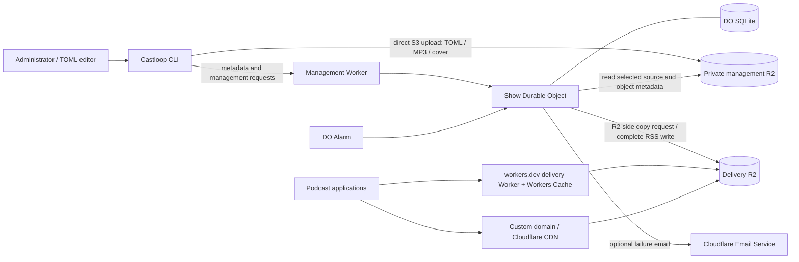

# Castloop MVP

* **Author:** Akira Shimosako
* **Status:** Draft — Overview and Goals, Technical Plan, and Alternatives Considered approved. Explicit open choices remain before implementation.
* **Date:** 2026-11-07
* **Predecessor:** [Consolidated concepts brief](./concepts_brief.md)

## Overview

Castloop lets one administrator publish public podcasts in their own Cloudflare account. The administrator edits show and episode metadata as TOML and uses a standalone CLI to transfer metadata, upload media and inspect publication results. Listeners receive podcast RSS, cover images and MP3 audio through Cloudflare.

An installation can start without a custom domain. As delivery grows, the administrator can switch to an R2 custom domain served through Cloudflare CDN, removing the delivery Worker from listener requests while preserving old links through redirects.

The MVP covers the full basic publishing lifecycle: create a show, add and schedule episodes, update metadata or audio, and withdraw episodes or a show. It prioritizes a small implementation, useful failure reporting and inexpensive operation. Public delivery may be temporarily inconsistent during a failed or overlapping operation; recovery reapplies the latest accepted administrator intent.

## The Problem

An individual podcast publisher needs a way to manage RSS and media without manually editing XML or operating a separate hosting system. Uploading audio, changing metadata and scheduling release must produce consistent intended content without requiring the administrator's computer to remain running.

Local editing introduces stale-file conflicts, while interrupted uploads and server failures can leave preparation unfinished. Castloop must preserve the administrator's work, make the point of source acceptance clear, and distinguish accepted changes from completed public delivery. A minor invalid show edit must not unexpectedly stop an established feed.

Growing episode archives and listener traffic also affect costs. The design must avoid routing large uploads through Workers or copying an entire audio archive for an ordinary metadata edit. It should use Cloudflare free allowances where practical without claiming an unmeasured capacity guarantee.

## Goals

* Let one administrator manage multiple public podcast shows in their own Cloudflare account through a TypeScript CLI distributed as Bun-built standalone executables.
* Support TOML-based show and episode creation and editing, separate MP3 and cover uploads, audio replacement, and intentional withdrawal/deletion.
* Produce complete RSS from validated metadata based on Apple Podcasts guidance and RSS 2.0, with accessible media and stable episode identities.
* Release eligible future episodes automatically after the CLI exits, normally within one or two minutes of the specified instant. Preserve each episode's stored timezone interpretation across show-default timezone changes.
* Reject TOML syntax errors before remote changes. Retain parseable incomplete input with actionable errors; withdraw invalid episodes while preserving established delivery after invalid show edits.
* Protect local work through metadata-only pull/push, stale-update checks and unique backups of divergent local edits. Do not require downloading the MP3 archive.
* Accept a prepared source update atomically through SQLite-selected immutable R2 references. Make repeated uncertain requests safe without replaying stale intent.
* Serve approved content without a custom domain, and allow later CDN delivery through a custom domain with old endpoint redirects.
* Preserve source versions and their ownership/time records for inspection and explicit cleanup. Provide minimal manual management export/restore.
* Record publication failures, expose them through read-only checks, optionally email the administrator, and allow explicit recovery from current accepted input. Rebuild affected media and complete RSS from the beginning.

## Non-Goals

* Multiple administrators, listener accounts, private podcasts or an authorization hierarchy.
* Castloop listener analytics, audio transcoding, recording, editing or recalling downloaded audio.
* Git/GitHub integration as a requirement, automatic TOML merging, built-in diff tools or MP3 archive synchronization.
* Generated podcast websites in the MVP. Static show/episode pages with browser playback are a later extension.
* A restore-previous-version feature, continuous backup service or automatic source cleanup. Retaining old material does not implement rollback.
* Automatic application retries, a durable ordered job queue, distributed locks, processing-stage resume or an atomic transaction across all public objects and caches.
* Guaranteed exact-second release, immediate appearance in external podcast applications, zero temporary public inconsistency or guaranteed free-tier operation at an unspecified scale.

## Critical User Journeys

### CUJ 1: Create and release an episode

* **Given:** An installation has a valid show, and the administrator has its metadata locally.
* **When:** The administrator edits episode TOML, uploads its MP3 and pushes eligible metadata.
* **Then:** Castloop records accepted source references, makes due media accessible and regenerates RSS. Future episodes remain private until their release instant. The CLI distinguishes accepted, scheduled, applied and incomplete results.

### CUJ 2: Edit metadata from another computer

* **Given:** Remote metadata and an older local copy may both contain edits.
* **When:** The administrator pulls metadata.
* **Then:** Castloop preserves divergent local edits in a uniquely named backup, installs current remote TOML and records its baseline. No MP3 archive is downloaded and nothing is published by pull.

### CUJ 3: Correct invalid metadata or withdraw content

* **Given:** An episode or show is already public.
* **When:** The administrator submits invalid publication metadata or an intentional stop.
* **Then:** An invalid episode loses its public audio and RSS entry; an invalid show preserves its last valid delivery and blocks episode updates/releases. A confirmed show stop withdraws its feed and media. Declining confirmation changes no accepted intent.

### CUJ 4: Recover an interrupted operation

* **Given:** An upload, acceptance response or publication attempt was interrupted.
* **When:** The administrator reruns an uncertain acceptance request or explicitly retries failed publication.
* **Then:** The former uses its saved operation identity without overwriting newer input. The latter reloads current accepted input and restarts affected public work from deletion, without stage-resume logic. Private source remains available.

## Technical Plan (Architecture)

### 1. Components and boundaries



The two listener paths are deployment modes. When migrating to a custom domain, the old workers.dev path remains as a redirect endpoint. Custom-domain listeners do not pass through the delivery Worker.

The management Worker authenticates requests and routes by show ID to a deterministically named show DO. It does not render RSS or parse audio. Each show DO owns its SQLite tables, scheduled work and publication execution. It does not coordinate unrelated shows.

TOML and media bodies live in immutable management R2 objects. SQLite selects the accepted versions. Delivery R2 contains only generated RSS and approved media. No second live selection manifest, D1 database, Queue, Agents SDK or Cron is introduced.

All management reads and mutations require installation-level administrator authentication. No listener request accesses a management route. The exact authentication mechanism is an open choice in section 13; this draft does not silently select one.

### 2. Identity, source objects and local layout

The accepted identifier format is `s-` for shows or `e-` for episodes followed by eight lowercase Base32 characters, for example `s-k7m3q9t2` and `e-v4n8wc6r`. Use cryptographically secure, unbiased randomness and the alphabet `0123456789abcdefghjkmnpqrstvwxyz`, which omits easily confused letters. IDs are ten characters including the prefix. They are identifiers, not credentials.

Eight Base32 characters provide 40 random bits, or 1,099,511,627,776 possibilities. For 1,000 independently generated IDs in one namespace, the probability of any collision before checking is approximately 0.0000454%. Randomness does not guarantee uniqueness: show creation checks the deterministically addressed DO's existing control record, and episode creation enforces uniqueness within its show in SQL. On a confirmed collision for a new entity, CLI generates another candidate. An uncertain retry keeps the original operation and target IDs. Route and TOML identities must agree. No global episode registry is needed; episode operations include show context.

Proposed immutable management keys preserve show/episode ownership:

```text
<show-id>/_versions/<operation-id>/show.toml
<show-id>/_versions/<operation-id>/cover.jpg
<show-id>/<episode-id>/_versions/<operation-id>/episode.toml
<show-id>/<episode-id>/_versions/<operation-id>/audio.mp3
```

These are object keys, not directories that R2 creates or renames. Prepared objects become accepted by SQL reference selection, without moving their bodies. A metadata-only edit reuses the selected audio reference. No unconditional expiry rule applies to `_versions/`.

The administrator's workspace remains simple:

```text
.castloop/state.json
<show-id>/show.toml
<show-id>/<episode-id>/episode.toml
```

Local audio files need not mirror all remote versions. The cover filename in TOML is a logical source name within the show; SQLite resolves that name to an immutable stored object. Pull materializes selected TOML at the local canonical paths rather than exposing version-key layout as an editing requirement.

Episode RSS GUIDs remain stable and independent of mutable URLs. The previous proposal derived a `urn:uuid:` GUID from the UUID inside the episode ID. With short management IDs, that derivation no longer applies. Retaining the same GUID format would require generating and persisting an independent UUID at episode creation; alternatively, GUIDs can use a stable show/episode-ID-based value. This representation remains an explicit open choice; never label a short non-UUID identifier as `urn:uuid:`. In either case emit `isPermaLink="false"` and preserve the GUID across metadata, media and domain changes.

### 3. SQLite information model

The following groups describe required information, not a mandated number of physical tables. There is no per-copy or per-render processing-stage journal.

| Group | Minimum information | Purpose |
| --- | --- | --- |
| Show control | Show ID; schema version; accepted revision; last accepted operation ID and fingerprint; accepted show TOML/cover references | Select current source and detect stale or repeated requests |
| Episodes | Episode ID; selected TOML/audio references; media identity, byte size, duration and MIME type; resolved release instant; publication intent | Build and schedule current episodes without reading MP3 bodies |
| Publication outcomes | Desired work identity; last completed feed outcome; affected episode outcomes; unresolved error/retry requirement | Distinguish source acceptance from applied delivery, including withdrawals |
| Last valid delivery references | References needed by the last valid show feed and its media/artwork | Protect working delivery after invalid show input and during source cleanup |
| Source asset ledger | Object key; owner show/episode; kind; preparation operation; registration/storage time; confirmed size and identity | Account for active, historical and abandoned source material |
| Current failure state, within publication outcomes | Target; revision/operation; incomplete or failed state; compact code/message; failure time and notification outcome | Keep unresolved work visible to check/recovery after diagnostic logs expire; no separate error-history table |

Detailed diagnostics and exception stacks go to Cloudflare Workers Logs, not SQLite. The current failure state above is operational state, not a log archive. SQLite does not store every error event or implement a log viewer.

An outcome includes whether intended public absence has been applied. Removing an episode must not immediately erase the identity needed to finish its public cleanup.

Source revision alone cannot identify completed delivery: a scheduled release can change RSS without a source edit. Publication outcomes must also distinguish the eligible release set and affected media identities. Exact columns and the representation of this work identity are deferred to Detailed Implementation.

The source ledger is an inventory, not a complete historical show snapshot. Retaining identifiable assets does not promise restore-previous-version functionality.

### 4. Preparing and accepting an update

The acceptance boundary follows this sequence:

1. CLI parses TOML before any remote mutation, checks identity and supported format, normalizes missing episode timezone, and inspects any changed media locally. It obtains the current accepted revision and preserves a local receipt containing operation ID and request fingerprint.
2. CLI prepares unique immutable management objects. MP3s go directly through S3-compatible R2 requests. Object preparation cannot change accepted source or public delivery.
3. After upload completion, CLI submits expected revision, operation identity, selected-object changes and media facts to the management Worker. The DO validates that all references belong to this installation and show, checks object presence/identity and applies acceptance eligibility rules.
4. In one SQL transaction, recognize a matching last accepted operation before rejecting its old expected revision. Otherwise recheck the expected revision and relevant current show state, select all changed references, advance revision and persist required publication outcomes. Roll back on rejection.
5. After acceptance, execute publication against latest selected source. Return source acceptance separately from validation and delivery results. Persist the new local baseline only for the accepted remote content.

Object reads and copy/network calls are outside the SQL acceptance transaction. `transactionSync()` supports synchronous SQL and rolls back when its callback throws; it cannot contain awaited R2 calls. See [SQLite storage transactions](https://developers.cloudflare.com/durable-objects/api/sqlite-storage-api/#transactionsync).

The proposed pre-upload asset registration call is still an explicit open choice. If selected, it only records planned ownership and does not advance source revision or publish anything. Its failure and cleanup semantics are described in section 11.

| Interruption | Durable result | Administrator action |
| --- | --- | --- |
| Before final acceptance | Old selected source; possibly unused private objects | Repeat preparation/request or inspect leftovers later |
| Before SQL commit | Old selected source | Repeat the saved request |
| Commit succeeds, response lost | Whole new source selection accepted | Retry matching operation; do not accept it twice |
| Delivery fails after acceptance | New source selected, public outcome incomplete | Inspect error and retry publication from current input |
| A newer operation has committed | Newer selection remains authoritative | Reject stale operation and pull; do not replay old intent |

The last-operation receipt is sufficient for an immediate duplicate. This does not introduce an indefinite operation history just to report an older request as successful after later changes. Reusing an operation ID with different contents is rejected.

### 5. Metadata pull and push

The hidden local state records each canonical TOML's downloaded content digest, object identity/ETag and accepted revision. ETags are opaque object identities, not filesystem timestamps or universal content hashes. SQL revision protects reference selection even when a prepared R2 object's ETag has not changed.

Pull first obtains a consistent metadata inventory for the show and fetches its selected immutable TOML. Fetch before replacing local data. For each file:

| Local relative to baseline | Remote relative to baseline | Result |
| --- | --- | --- |
| Unchanged | Unchanged | Keep file and baseline |
| Changed | Unchanged | Keep local edits |
| Unchanged | Changed | Install fetched remote content and baseline |
| Changed | Changed to identical local content | Keep that content and advance baseline |
| Changed | Changed differently | Preserve local in a unique backup, install remote, then advance baseline |

Backups are never uploaded as metadata. Failed backup creation leaves the original file intact. Missing local files do not imply remote deletion. Missing baselines and remote tombstones must preserve local material and report the situation; exact CLI messages belong in Detailed Implementation.

Push sends changed metadata against the downloaded accepted revision. A conflict requires refreshing the baseline rather than silently overwriting newer intent. Show-level revisions can conservatively reject an unrelated concurrent edit within the same show; this is acceptable for one administrator and avoids multi-entity merge logic.

### 6. Validation and metadata rendering

Shared TypeScript domain helpers provide TOML parsing, metadata validation, timezone normalization and XML rendering behavior usable by CLI and DO. The CLI performs mandatory syntax preflight and inspects media; the DO remains responsible for current publication eligibility. Client-side validation is not permission to skip server checks.

Keep acceptance validation distinct from publication readiness. Malformed input, identity mismatch, unsupported protocol/schema and stale revision reject acceptance. Missing publication fields or audio in otherwise identifiable, parseable input can be saved and reported as unpublishable. Episode add/update is rejected while current show TOML is invalid.

The proposed field mapping and example TOML remain in [toml_spec.md](./toml_spec.md). Required/recommended RSS metadata, limited description HTML, cover requirements and generated enclosure facts must be carried into the implementation schema. The exact HTML allowlist and optional advanced fields are still explicit open choices. Never treat this mapping proposal as an approved all-fields MVP dependency list.

Generate complete well-formed RSS with escaped text and safe CDATA handling. Generate enclosure URL, byte length, MIME type and duration from selected media facts rather than user-maintained TOML values. Validate object identity against the inspected media revision; do not parse remote MP3s on each reservation or metadata check.

Resolve an episode's local datetime using its stored IANA timezone, producing a persisted instant and an RSS datetime with an offset. Report ambiguous or nonexistent local times rather than choosing silently. The exact input representation for resolving those cases remains open. Show default changes do not rewrite existing episode instants.

### 7. One publication executor

Accepted changes, due reservations and administrator recovery use the same executor. A run reloads latest accepted references; it never trusts a saved old command as the current desired publication plan.

1. Validate current show and load publication prerequisites before deleting anything public. Invalid show input preserves the last working feed and its required media/artwork, reports errors and blocks new releases.
2. A confirmed show stop or deletion withdraws its feed and public assets, purges affected cache prefixes and disables reservations while the show remains stopped.
3. For a valid active show, determine due, valid, enabled episodes. Future episodes remain private. Invalid or disabled episodes are absent from the intended feed and public audio set.
4. Build and validate the entire candidate XML before destructive delivery changes where possible.
5. Apply affected media only. A first publication, audio replacement or explicit recovery deletes the affected public files and copies current eligible source through R2-side `CopyObject`; withdrawal deletes without recopying. Metadata-only changes do not recopy unchanged successful audio.
6. Purge affected media paths, including stale missing-object responses, before advertising new media in RSS. Then delete/recreate the whole feed and purge its cache path.
7. Record completion only if the accepted revision and due-work identity still match the run. If newer accepted work exists, leave it pending and process current intent within the available invocation budget.

Copying and feed regeneration are separate external operations. A failure may leave temporarily missing or stale public content and is reported as incomplete. Recovery repeats the entire affected operation from deletion; no completed-stage cursor is stored.

Use one active in-memory publication runner per show to avoid ordinary overlapping runs. New accepted intent remains durable in SQL and may coalesce; it is not an in-memory-only queue. Do not hold a SQL transaction or broad `blockConcurrencyWhile()` across external R2/cache calls. A terminated runner may leave incomplete work, which diagnostics and explicit recovery must expose. This is not a distributed lock or a promise that external stale writes can never finish later.

A newer accepted change is new work, not permission to silently retry every unrelated failed release. Failure eligibility must remain distinct from unattempted due work so rebuilding RSS for another episode does not accidentally advertise a failed release.

### 8. Reservations and alarm boundaries

Each show DO schedules its earliest eligible unattempted release. One DO can have one alarm; later reservations are represented in SQL rather than one timer per episode. Alarm execution rereads current flags, timezones, source identities and show validity. It never publishes an abandoned upload or a superseded reservation.

After a normal invocation, select the next future eligible reservation. A failed past-due target is marked incomplete and excluded from automatic rearming. A valid show repair explicitly reevaluates overdue eligible episodes; unpublished or still-invalid episodes remain private.

An alarm handler catches expected publication failures, records the compact current failure outcome in SQLite, emits diagnostic details to Workers Logs and returns without arranging an application retry. Platform alarms provide at-least-once execution and may retry uncaught exceptions; durable completion/failure outcomes prevent known finished or failed work from being treated as fresh. Hard termination can still cause platform redelivery. See [DO alarm semantics](https://developers.cloudflare.com/durable-objects/api/alarms/).

**Open transaction boundary:** Saving a new reservation and scheduling its alarm must not leave a committed reservation with no wakeup because the process stopped between those operations. Two possible mechanisms are recorded in section 13. `setAlarm()` is asynchronous, so placing it inside a synchronous SQL callback is not a valid implementation. This boundary requires selection and a crash test before the plan is implementation-ready.

For immediate publication, an interrupted accepted operation can remain pending for administrator recovery. Do not add a hidden retry alarm merely to repair it. Future reservation arming and failed-publication recovery have different purposes.

### 9. Delivery, caching and migration

Use these public paths:

| Resource | Path |
| --- | --- |
| Show feed | `/<show-id>/feed.xml` |
| Episode MP3 | `/<show-id>/<episode-id>/audio.mp3` |
| Cover version | `/<show-id>/covers/<revision>.jpg` or `.png` |

Without a custom domain, the delivery Worker uses its private R2 binding. Implement GET, HEAD and byte-range responses without buffering full audio. Management endpoints never share public cached responses. Configure the selected Workers Cache rather than relying on the geographically local legacy `caches.default.delete()` behavior.

The cached delivery entrypoint owns its purge operation. A protected service binding invokes an authenticated maintenance method on that same entrypoint, which calls `ctx.cache.purge({pathPrefixes})` and checks `success`/`errors`. Purging from a separate entrypoint does not purge the delivery entrypoint's cache. See [Workers Cache purge scopes](https://developers.cloudflare.com/workers/cache/purge/).

With a custom domain, R2 custom-domain delivery and zone cache rules serve approved objects without a delivery Worker. Disable `r2.dev`. The bucket is publicly accessible through that CDN hostname; authenticated S3 access is a separate administrator path. Configure RSS/XML caching explicitly rather than assuming extension defaults cache it.

All successful feed/media responses use the agreed policy `Cache-Control: public, max-age=0, s-maxage=2592000, must-revalidate`. Purge feed and affected media after changes; a show-wide withdrawal purges its show prefix. Cache errors are incomplete publication, not success. Do not add a short-TTL insurance mechanism or global-cache audit. Negative responses must not retain long freshness after publication.

Batch custom-domain purge prefixes within platform limits, covering relevant query variants. Rate-limit rejection is recorded and reported without automatic retry. Check the documented [zone purge limits](https://developers.cloudflare.com/cache/how-to/purge-cache/) when implementing batch behavior.

During migration, create and test the new domain path, update generated URLs, rebuild RSS and purge affected caches. Keep GUIDs unchanged and old workers.dev paths redirecting to their corresponding new URLs. Redirect status, feed migration signaling and the administrative switch/rollback procedure remain open; no automatic expiry of old endpoints is selected.

### 10. Errors, check and administrator recovery

Management responses carry acceptance state, accepted revision/operation, validation issues and delivery outcome separately. A non-success publication result must still tell the CLI whether source was accepted. Exact transport status and exit-code mapping are deferred, so callers must not infer acceptance solely from HTTP success/failure.

`castloop check` is read-only. It loads selected metadata, validates it, checks referenced object metadata and reports unresolved delivery/notification errors. It does not download the archive, mutate source, release overdue episodes or delete invalid public resources. Public HEAD/range probes are diagnostics distinct from source validity.

Use Cloudflare Workers Logs for structured diagnostic events and exception stacks. Include show ID, episode ID when applicable, operation ID, accepted revision, trigger/action and error code so administrators can filter related events in Cloudflare's dashboard. Enable logging for the management Worker and its DO class. DO logs are available through the namespace's Observability tab. See [Workers Logs](https://developers.cloudflare.com/workers/observability/logs/workers-logs/) and [DO logging](https://developers.cloudflare.com/durable-objects/observability/metrics-and-analytics/#view-logs).

SQLite retains only each target's current unresolved failure outcome and compact actionable reason, as part of publication state. Persist this before optional email. Detailed event history and stacks are not copied into SQL. Platform log retention must not determine whether Castloop remembers a known failed release: `castloop check` still reports it after logs expire, and later reservations must not mistake it for unattempted work. No custom log collection pipeline, SQL log viewer or required Workers Issues integration is introduced.

Keep failure state for unrelated unresolved targets when another operation succeeds. A successful recovery clears/resolves only the failures it actually addresses. Never log credentials or publish private administrator fields.

If mail is configured, send to the verified administrator destination from the configured sender domain. Otherwise report notification as unconfigured and keep normal publishing available. Mail failure is recorded separately and does not repeat publication or trigger an email recursion.

Explicit recovery rechecks latest show validity and desired state, deletes affected public files and regenerates full RSS. It does not restore old metadata or resume a previous processing stage. If the latest intended state is withdrawal, recovery removes public files rather than restoring audio.

### 11. Retained assets and manual cleanup

The asset ledger records which source object belongs to which show/episode, what kind it is, when it was registered/stored and its confirmed identity/size. Older versions stay private and retained until explicit cleanup. Current selected and last-valid-delivery references are protected.

One candidate registration mechanism adds a small pre-upload preparation request: register intended keys and ownership, upload directly, then confirm identities during acceptance. A row may refer to an upload that never completed; a completed object may still have only planned status after CLI failure. Manual inventory reconciles R2 presence without accepting the object. The alternative is inventory registration from attributable keys; neither mechanism is selected yet.

Cleanup previews candidate keys, ownership and sizes and requires confirmation. Recheck references before deletion; never infer that all assets are unused when SQL is missing or unavailable. Report partial failures while retaining enough inventory to inspect what remains. Avoid a continuous garbage-collection service.

Logical show/episode removal and permanent private-source erasure must be distinct operations. Retaining management rows/assets after normal removal is the ledger proposal, pending selection in section 13. A public show deletion must not blindly destroy its DO database and ledger.

### 12. Manual export/restore and compatibility

A management export includes schema/protocol versions, accepted references, operation identities, release instants, publication/error outcomes and source ledger. Export each show's SQL data from one consistent read boundary before performing external object inspection. Across shows, document per-show snapshots rather than promise an installation-wide transaction.

Metadata export does not copy MP3 bodies. It must identify the R2 objects required by its snapshot and distinguish an available original archive from an independent media backup. Restore verifies supported versions and required object identities before replacing selected state. Restore must not automatically resurrect public content or rearm stale past-due work without an explicit documented recovery decision.

The exact export envelope, missing-object behavior and replacement confirmation need definition before implementation. There is no continuous backup service or R2-only reconstruction claim.

Management protocol, TOML format, export format and SQLite schema carry explicit versions. Reject unsupported incoming versions before mutation. Normalization must not silently discard unknown user fields. Choose concrete parser/media/HTML dependencies and define supported optional fields during Detailed Implementation, after the relevant remaining choices are resolved.

### 13. Open choices carried forward

The following are unselected implementation choices. Approving the architecture section does not select a row's alternatives implicitly. Resolve them individually before the Detailed Implementation Plan is finalized.

| Choice | Options and mechanisms | Trade-off / failure boundary |
| --- | --- | --- |
| Management authentication | Installation bearer secret stored as Worker secret and local CLI credential; or Cloudflare Access service-token protection | Bearer needs explicit secret setup/rotation; Access adds account configuration and service-token lifecycle. Either requires authenticating all management routes. |
| Asset registration | Pre-upload DO registration; or direct upload with ownership in keys and explicit inventory registration | Pre-registration adds a request but accounts for intent before upload; later inventory avoids the request but cannot immediately enumerate all abandoned files from SQL alone. |
| Reservation/alarm atomicity | Storage transaction containing SQL and Alarm API operations; or arm a conservative wakeup before the final synchronous acceptance transaction | First depends on verified mixed-storage transaction behavior and tests; second can leave harmless extra wakeups and must preserve any earlier reservation. Neither includes R2 I/O. |
| Normal deletion of private source | Retain tombstoned management entities/assets until explicit cleanup; or erase their source through a separately confirmed destructive operation | Retention preserves future recovery material; erasure loses it and needs exact scope. Public withdrawal is required in either case. |
| Discovery of shows | Enumerate attributable management R2 show prefixes and query their DOs; or retain a small installation catalogue | Prefix enumeration avoids another live store but must handle unaccepted preparations; a catalogue requires its own consistency rules. No global registry has been selected. |
| RSS GUID representation | Generate and persist an independent UUID-based GUID at creation; or use an immutable show/episode-ID-based value | Both preserve identity across URL changes; the first stores another identifier, while the second changes the earlier UUID-based representation. The short CLI identifier is already agreed. |
| Remaining external details | Exact CLI/API schemas, cover command association, HTML scope, DST disambiguation, deletion HTTP status, migration redirect/RSS signaling and export/restore behavior | These affect administrator or listener behavior and must be explicit before implementation rather than guessed by an implementation agent. |

No capacity limit or Free-plan fit is asserted. Verify representative episode archives, SQL/R2 operation counts, CPU/runtime, large direct upload, server-side copy, range serving, reservation crash boundaries and purge behavior before setting supported limits.

### 14. Proposed source areas

The repository currently contains design documents, so these are proposed new implementation areas rather than existing code being changed:

| Area | Responsibility |
| --- | --- |
| `packages/domain/` | Metadata types, validation, normalization, source identities, RSS rendering and protocol schemas |
| `packages/cli/` | Commands, local baselines/backups, media inspection, direct S3 client and Bun binary build |
| `packages/worker/` | Management entrypoint, show DO/SQLite, publication, alarms, R2-side copy, cache maintenance and error notification |
| `packages/delivery/` | workers.dev R2 serving, HEAD/range handling, same-entrypoint purge and later migration redirects |
| Deployment configuration and guides | Buckets/bindings/secrets, optional custom domain/cache/mail setup and manual recovery |

The Detailed Implementation Plan will enumerate every concrete source, configuration, documentation and test file, with its rationale. This section does not authorize production implementation.

## Alternatives Considered

These alternatives come from the predecessor's recorded decisions and the approved Technical Plan review. They explain the chosen direction; they do not turn the open choices in Technical Plan section 13 into rejected options.

### 1. Proxy MP3 uploads through a Worker

* **Benefit:** CLI could use one management API without separate direct-object access.
* **Cost:** Large audio bodies would pass through the Worker, adding request-size and execution constraints to the upload path. Success with a 50 MB example would not establish support for larger files.
* **Decision:** Rejected by author: upload audio directly from CLI to management R2 through its S3-compatible API. Keep the Worker for small management requests. Promotion requests use R2-side copying rather than transferring MP3 bodies through the DO.

### 2. Require native R2 APIs for every operation

* **Benefit:** A uniform Cloudflare-native interface would avoid introducing an S3-compatible client and its credentials.
* **Cost:** Uniformity would not satisfy the selected direct-upload and R2-side-copy path with the same API surface. Routing file bodies through a Worker merely to use bindings would conflict with the upload decision.
* **Decision:** Rejected by author as a constraint: accept S3 credentials for direct object operations and use native bindings where appropriate. Supporting another cloud provider is not a goal of this choice.

### 3. Generate RSS in the CLI behind a manual publish command

* **Benefit:** Feed generation would use the administrator's local CPU and avoid server-side XML generation.
* **Cost:** An unattended scheduled release would still need Cloudflare-side execution or prepared future feeds with their own invalidation rules. Requiring another command would separate ordinary metadata updates from automatic publication.
* **Decision:** Rejected by author: the show DO generates complete feeds automatically after accepted changes and at release time. There is no normal manual publish gate. Explicit recovery of failed publication is a separate administrative action.

### 4. Generate the feed in an ordinary Worker and scan with Cron

* **Benefit:** A management Worker could combine routing, periodic discovery and feed generation without a show-specific executor.
* **Cost:** Feed generation and archive reads would rely on the ordinary Worker execution allowance. Periodic scans would also need rules distinguishing accepted changes from abandoned preparation and failed work from unattempted reservations.
* **Decision:** Rejected or superseded by author: use one DO per show for feed execution and a DO alarm for its next reservation. CLI uploads become accepted only through the explicit SQLite acceptance transaction. No Cron scan accepts leftovers or retries failed publication.

### 5. Select current versions through an R2 manifest or a separate D1 store

* **Benefit:** An R2 manifest could make one object the selection boundary; D1 could provide a shared relational store across shows.
* **Cost:** An authoritative manifest would still need integration with the selected DO executor, reservations and outcomes. D1 would add a separate database boundary to per-show state. Keeping either as a second live authority alongside SQL-selected references would require synchronization rules.
* **Decision:** Rejected by author in favor of show-local DO SQLite: commit accepted source references and operation identity there. R2 retains immutable bodies. SQLite is persistent management data, not a disposable index reconstructible from arbitrary R2 objects. Manual export/restore addresses that responsibility.

### 6. Use Git/GitHub or synchronize the entire media archive

* **Benefit:** Git offers history, diffs and merge tools for metadata. Full synchronization gives every computer a local copy of the complete archive.
* **Cost:** Git/GitHub would become an external workflow dependency. Full media synchronization makes a new workspace download potentially large MP3 archives. Automatic merge and a built-in diff interface add behavior beyond the selected MVP.
* **Decision:** Rejected by author for the MVP: pull/push metadata only, keep audio transfer separate, and preserve divergent local TOML in unique backup files. The administrator compares and edits those files using their own tools. Missing local files never imply remote deletion.

### 7. Enforce strict public isolation with distributed locks or an ordered queue

* **Benefit:** Serial execution could prevent some CLI/alarm overlap and reduce temporary stale public writes.
* **Cost:** A strict lock needs ownership and failure-release rules. An ordered queue needs ordering, duplicate and interruption semantics. Neither alone creates a transaction across SQLite, public R2 objects and caches.
* **Decision:** Rejected by author as a baseline requirement: temporary public inconsistency is acceptable when recovery can apply latest accepted intent. Use durable desired/outcome state and a small per-show runner, not a custom FIFO or distributed lock service. Source acceptance still requires its SQL transaction and stale-update checks.

### 8. Resume publication at the last completed processing stage

* **Benefit:** A retry could skip copies or rendering already completed before a failure.
* **Cost:** Determining which partial effects remain valid requires stage records and rules for source changes, incomplete copies and cache operations. The extra machinery is not justified for the selected workload.
* **Decision:** Rejected by author: restart affected publication from deletion using current accepted input and regenerate the whole RSS document. Preserve unrelated unchanged audio. Do not store processing-stage cursors or patch XML incrementally.

### 9. Automatically retry failed publication

* **Benefit:** Transient failures could clear without administrator action.
* **Cost:** The application would need retry limits, backoff and rules preventing a later reservation from repeatedly reviving a failed target. Repetition can obscure a persistent error rather than explain it.
* **Decision:** Rejected by author for the MVP: record current failure state, emit diagnostics, optionally email the administrator and support explicit recovery. Do not rearm failed past-due work as an application retry. Platform alarm redelivery remains a separate execution characteristic.

### 10. Use short cache lifetimes as insurance against purge failure

* **Benefit:** Old responses would expire sooner if an update or withdrawal failed to purge them.
* **Cost:** Short freshness reduces cache reuse even when normal purge succeeds. It would add a fallback policy the author does not require.
* **Decision:** Rejected by author: use the agreed 30-day shared freshness, client revalidation and explicit purge. Trust the documented Cloudflare purge contract, check normal errors and report failure as incomplete publication. Do not add a global-cache audit or promise recall of files already downloaded.

### 11. Build an application error-log archive in SQLite

* **Benefit:** Castloop could keep and query detailed historical errors independently of platform log retention.
* **Cost:** It would need storage/retention rules and a log-viewing interface, duplicating available Cloudflare diagnostics.
* **Decision:** Rejected by author during Technical Plan review: put diagnostic events and exception stacks in Workers Logs. SQLite retains only compact current unresolved outcomes needed by check, scheduling and recovery. Log expiry must not make a known failed release appear unattempted.

### 12. Include listener analytics and generated podcast websites in the MVP

* **Benefit:** The administrator could inspect popularity and listeners could browse/play episodes directly on a Castloop-generated site.
* **Cost:** Analytics would need a measurement contract across both delivery paths, while generated websites add HTML output, navigation and rebuild behavior beyond RSS/media hosting.
* **Decision:** Rejected by author for MVP scope: omit Castloop analytics and allow administrators to use external distribution-platform statistics. Generated static podcast websites remain a planned extension, including dates displayed in the current show timezone. Their custom-domain requirement is still undecided.

## Subsequent Sections

Alternatives Considered is approved. Next, resolve the explicit open choices in Technical Plan section 13 and draft the Detailed Implementation Plan. Approval of the preceding sections does not silently choose among those alternatives.

*Drafted with EGM*
