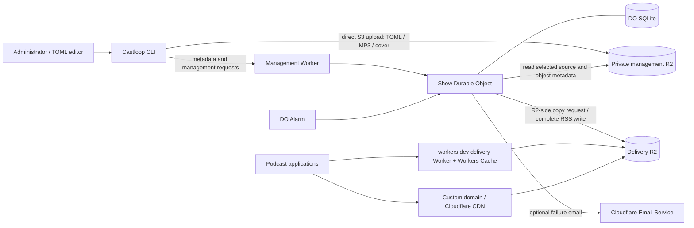

# Castloop MVP

* **Author:** Akira Shimosako
* **Status:** Finalized — the author concluded the EGM review and confirmed this design on 2026-11-08. All design sections, individual decisions 1–11, the combined Detailed Implementation Plan and approved Stage 5, Stage 7 and all seven Stage 9 resolutions are reflected here. Implementation has not started. The author selected finalization without a post-edit re-audit; review-loop convergence and runtime readiness are not claimed.
* **Date:** 2026-11-08
* **Predecessor:** [Consolidated concepts brief](../../concepts_brief.md)

## Overview

Castloop lets one administrator publish public podcasts in their own Cloudflare account. The administrator edits show and episode metadata as TOML and uses a standalone CLI to transfer metadata, upload media and inspect publication results. Listeners receive podcast RSS, cover images and MP3 audio through Cloudflare.

An installation can start without a custom domain. As delivery grows, the administrator can switch to an R2 custom domain served through Cloudflare CDN, removing the delivery Worker from listener requests while preserving old links through redirects.

The MVP covers the full basic publishing lifecycle: create a show, add and schedule episodes, update metadata or audio, and withdraw episodes or a show. It prioritizes a small implementation, useful failure reporting and inexpensive operation. Public delivery may be temporarily inconsistent during a failed or overlapping operation; recovery reapplies the latest accepted administrator intent.

## The Problem

An individual podcast publisher needs a way to manage RSS and media without manually editing XML or operating a separate hosting system. Uploading audio, changing metadata and scheduling release must produce consistent intended content without requiring the administrator's computer to remain running.

Local editing introduces stale-file conflicts, while interrupted uploads and server failures can leave preparation unfinished. Castloop must preserve the administrator's work, make the point of source acceptance clear, and distinguish accepted changes from completed public delivery. A minor invalid show edit must not unexpectedly stop an established feed.

Growing episode archives and listener traffic also affect costs. The design must avoid routing large uploads through Workers or copying an entire audio archive for an ordinary metadata edit. It should use Cloudflare free allowances where practical without claiming an unmeasured capacity guarantee.

## Goals

* Let one administrator manage multiple public podcast shows in their own Cloudflare account through a TypeScript CLI distributed as Bun-built standalone executables.
* Support TOML-based show and episode creation and editing, separate MP3 and cover uploads, audio replacement, and intentional withdrawal/deletion.
* Produce complete RSS from validated metadata based on Apple Podcasts guidance and RSS 2.0, with accessible media and stable episode identities.
* Release eligible future episodes automatically after the CLI exits, normally within one or two minutes of the specified instant. Preserve each episode's stored timezone interpretation across show-default timezone changes.
* Reject TOML syntax errors before remote changes. Retain parseable incomplete input with actionable errors; withdraw invalid episodes while preserving established delivery after invalid show edits.
* Protect local work through metadata-only pull/push, stale-update checks and unique backups of divergent local edits. Do not require downloading the MP3 archive.
* Accept a prepared source update atomically through SQLite-selected immutable R2 references. Make repeated uncertain requests safe without replaying stale intent.
* Serve approved content without a custom domain, and allow later CDN delivery through a custom domain with old endpoint redirects.
* Preserve source versions and their ownership/time records for inspection and explicit cleanup. Provide minimal manual management export/restore.
* Record publication failures, expose them through read-only checks, optionally email the administrator, and allow explicit recovery from current accepted input. Rebuild affected media and complete RSS from the beginning.

## Non-Goals

* Multiple administrators, listener accounts, private podcasts or an authorization hierarchy.
* Castloop listener analytics, audio transcoding, recording, editing or recalling downloaded audio.
* Git/GitHub integration as a requirement, automatic TOML merging, built-in diff tools or MP3 archive synchronization.
* Generated podcast websites in the MVP. Static show/episode pages with browser playback are a later extension.
* A restore-previous-version feature, continuous backup service or automatic source cleanup. Retaining old material does not implement rollback.
* Automatic application retries, a durable ordered job queue, distributed locks, processing-stage resume or an atomic transaction across all public objects and caches.
* Guaranteed exact-second release, immediate appearance in external podcast applications, zero temporary public inconsistency or guaranteed free-tier operation at an unspecified scale.

## Critical User Journeys

### CUJ 1: Create and release an episode

* **Given:** An installation has a valid show, and the administrator has its metadata locally.
* **When:** The administrator edits episode TOML, uploads its MP3 and pushes eligible metadata.
* **Then:** Castloop records accepted source references, makes due media accessible and regenerates RSS. Future episodes remain private until their release instant. The CLI distinguishes accepted, scheduled, applied and incomplete results.

### CUJ 2: Edit metadata from another computer

* **Given:** Remote metadata and an older local copy may both contain edits.
* **When:** The administrator pulls metadata.
* **Then:** Castloop preserves divergent local edits in a uniquely named backup, installs current remote TOML and records its baseline. No MP3 archive is downloaded and nothing is published by pull.

### CUJ 3: Correct invalid metadata or withdraw content

* **Given:** An episode or show is already public.
* **When:** The administrator submits invalid publication metadata or an intentional stop.
* **Then:** An invalid episode loses its public audio and RSS entry; an invalid show preserves its last valid delivery and blocks episode updates/releases. A confirmed show stop withdraws its feed and media. Declining confirmation changes no accepted intent.

### CUJ 4: Recover an interrupted operation

* **Given:** An upload, acceptance response or publication attempt was interrupted.
* **When:** The administrator reruns an uncertain acceptance request or explicitly retries failed publication.
* **Then:** The former uses its saved operation identity without overwriting newer input. The latter reloads current accepted input and restarts affected public work from deletion, without stage-resume logic. Private source remains available.

## Technical Plan (Architecture)

### 1. Components and boundaries



The two listener paths are deployment modes. When migrating to a custom domain, the old workers.dev path remains as a redirect endpoint. Custom-domain listeners do not pass through the delivery Worker.

The management Worker authenticates requests and routes by show ID to a deterministically named show DO. It does not render RSS or parse audio. Each show DO owns its SQLite tables, scheduled work and publication execution. It does not coordinate unrelated shows.

Show discovery lists candidate show-ID prefixes in management R2, then queries each corresponding show DO for accepted existence and status. Do not add an installation-wide catalogue DO. The expected installation has roughly one to three shows, with around ten at the high end of normal use; this is a workload assumption, not a hard limit. Abandoned preparations are candidates only and do not create shows. A failed DO lookup produces an explicit error or incomplete listing rather than silently treating that show as absent. Accepted creation must leave discoverable management content. Do not add a permanent discovery marker. After explicit cleanup removes the last source object of a deleted show, it may disappear from ordinary R2-based listings; explain this before final cleanup. Its DO retains deletion, ownership and outcome records accessible by a known show ID. Missing prefixes do not authorize ID reuse; creation checks must still consult the target DO.

TOML and media bodies live in immutable management R2 objects. SQLite selects the accepted versions. Delivery R2 contains only generated RSS and approved media. No second live selection manifest, D1 database, Queue, Agents SDK or Cron is introduced.

All management reads and mutations require installation-level administrator authentication through an installation bearer secret, stored as a Worker secret and in the local CLI credential configuration. Every management route checks the secret before handling a request. No listener request accesses a management route. Cloudflare Access is not required for the MVP.

Use only the permissions and resource scopes needed for deployment, operation and delivery. The application bearer secret authorizes Castloop management requests; it is not a Cloudflare account API token or an R2 S3 credential. Keep those credentials separate from the bearer secret and out of synchronized TOML, exports and logs. Identify the required actions for each use and narrow credentials and bindings to the resources they need. The exact Cloudflare permission names, scopes and setup instructions will be refined and verified once the MVP runs; this deferral does not authorize unnecessarily broad access.

### 2. Identity, source objects and local layout

The accepted identifier format is `s-` for shows or `e-` for episodes followed by eight lowercase Base32 characters, for example `s-k7m3q9t2` and `e-v4n8wc6r`. Use cryptographically secure, unbiased randomness and the alphabet `0123456789abcdefghjkmnpqrstvwxyz`, which omits easily confused letters. IDs are ten characters including the prefix. They are identifiers, not credentials.

Eight Base32 characters provide 40 random bits, or 1,099,511,627,776 possibilities. For 1,000 independently generated IDs in one namespace, the probability of any collision before checking is approximately 0.0000454%. Randomness does not guarantee uniqueness: show creation checks the deterministically addressed DO's existing control record, and episode creation enforces uniqueness within its show in SQL. On a confirmed collision for a new entity, CLI generates another candidate. An uncertain retry keeps the original operation and target IDs. Route and TOML identities must agree. No global episode registry is needed; episode operations include show context.

Immutable management keys preserve show/episode ownership:

```text
<show-id>/_versions/<operation-id>/show.toml
<show-id>/_versions/<operation-id>/cover.jpg
<show-id>/<episode-id>/_versions/<operation-id>/episode.toml
<show-id>/<episode-id>/_versions/<operation-id>/audio.mp3
```

These are object keys, not directories that R2 creates or renames. Prepared objects become accepted by SQL reference selection, without moving their bodies. A metadata-only edit reuses the selected audio reference. No unconditional expiry rule applies to `_versions/`.

The administrator's workspace remains simple:

```text
.castloop/state.json
<show-id>/show.toml
<show-id>/<episode-id>/episode.toml
```

Local audio files need not mirror all remote versions. The cover filename in TOML is a logical source name within the show; SQLite resolves that name to an immutable stored object. Pull materializes selected TOML at the local canonical paths rather than exposing version-key layout as an editing requirement.

For newly created episodes, generate an independent UUIDv4 once and persist the complete RSS GUID as `urn:uuid:<UUID>`, with `isPermaLink="false"`. The GUID is separate from the short management ID and does not need to be typed for ordinary CLI operations. Preserve it across creation retries, metadata/audio edits, feed rebuilds, domain migration and export/restore. Store the complete value as immutable text rather than deriving it from a URL or enforcing a UUID-only storage column.

Importing podcasts from another environment is outside the MVP. A future importer must preserve the source episode's existing GUID rather than generating a new UUID or adding a `urn:uuid:` prefix to an existing value. Source GUIDs need not be UUIDs. Preserve GUID semantics, including the source permalink attribute where relevant, when defining that future feature; the MVP's generated GUID format must not prevent such preservation.

### 3. SQLite information model

The following groups describe required information, not a mandated number of physical tables. There is no per-copy or per-render processing-stage journal.

| Group | Minimum information | Purpose |
| --- | --- | --- |
| Show control | Show ID; schema version; accepted revision; last accepted operation ID and fingerprint; accepted show TOML/cover references | Select current source and detect stale or repeated requests |
| Episodes | Episode ID; immutable RSS GUID text; selected TOML/audio references; media identity, byte size, duration and MIME type; resolved release instant; publication intent | Preserve podcast identity and build/schedule current episodes without reading MP3 bodies |
| Publication outcomes | Desired work identity; last completed feed outcome; affected episode outcomes; unresolved error/retry requirement | Distinguish source acceptance from applied delivery, including withdrawals |
| Last valid delivery references | References needed by the last valid show feed and its media/artwork | Protect working delivery after invalid show input and during source cleanup |
| Source asset ledger | Object key; owner show/episode; kind; preparation operation; registration/storage time; confirmed size and identity | Account for active, historical and abandoned source material |
| Current failure state, within publication outcomes | Target; revision/operation; incomplete or failed state; compact code/message; failure time and notification outcome | Keep unresolved work visible to check/recovery after diagnostic logs expire; no separate error-history table |

Detailed diagnostics and exception stacks go to Cloudflare Workers Logs, not SQLite. The current failure state above is operational state, not a log archive. SQLite does not store every error event or implement a log viewer.

An outcome includes whether intended public absence has been applied. Removing an episode must not immediately erase the identity needed to finish its public cleanup.

Source revision alone cannot identify completed delivery: a scheduled release can change RSS without a source edit. Publication outcomes must also distinguish the eligible release set and affected media identities. The Detailed Implementation Plan, section 4, defines the SQL tables and separates the target eligibility signature from the revision-at-attempt completion guard.

The source ledger is an inventory, not a complete historical show snapshot. Retaining identifiable assets does not promise restore-previous-version functionality.

### 4. Preparing and accepting an update

The acceptance boundary follows this sequence:

1. CLI parses TOML before any remote mutation, checks identity and supported format, normalizes missing episode timezone, and inspects any changed media locally. It obtains the current accepted revision and preserves a local receipt containing operation ID and request fingerprint.
2. CLI prepares unique immutable management objects. MP3s go directly through S3-compatible R2 requests. Object preparation cannot change accepted source or public delivery.
3. After upload completion, CLI submits expected revision, operation identity, selected-object changes and media facts to the management Worker. The DO validates that all references belong to this installation and show, checks object presence/identity and applies acceptance eligibility rules.
4. In one SQL transaction, recognize a matching last accepted operation before rejecting its old expected revision. Otherwise recheck the expected revision and relevant current show state, select all changed references, advance revision and persist required publication outcomes. Roll back on rejection.
5. After acceptance, execute publication against latest selected source. Return source acceptance separately from validation and delivery results. Persist the new local baseline only for the accepted remote content.

Object reads and copy/network calls are outside the SQL acceptance transaction. Acceptance that updates reservations uses the selected asynchronous storage transaction so SQL and alarms share the boundary. `transactionSync()` supports synchronous SQL and rolls back when its callback throws; it cannot contain awaited R2 or alarm calls. See [SQLite storage transactions](https://developers.cloudflare.com/durable-objects/api/sqlite-storage-api/#transactionsync).

There is no pre-upload asset registration request in the MVP. CLI uploads to attributable immutable keys first. The acceptance transaction registers submitted, verified assets in the source ledger as it selects references. Abandoned uploads are registered later through explicit manual inventory; discovery alone never accepts source or publishes it. See section 11.

| Interruption | Durable result | Administrator action |
| --- | --- | --- |
| Before final acceptance | Old selected source; possibly unused private objects | Repeat preparation/request or inspect leftovers later |
| Before SQL commit | Old selected source | Repeat the saved request |
| Commit succeeds, response lost | Whole new source selection accepted | Retry matching operation; do not accept it twice |
| Delivery fails after acceptance | New source selected, public outcome incomplete | Inspect error and retry publication from current input |
| A newer operation has committed | Newer selection remains authoritative | Reject stale operation and pull; do not replay old intent |

The last-operation receipt is sufficient for an immediate duplicate. This does not introduce an indefinite operation history just to report an older request as successful after later changes. Reusing an operation ID with different contents is rejected.

### 5. Metadata pull and push

The hidden local state records each canonical TOML's downloaded content digest, object identity/ETag and accepted revision. ETags are opaque object identities, not filesystem timestamps or universal content hashes. SQL revision protects reference selection even when a prepared R2 object's ETag has not changed.

Pull first obtains a consistent metadata inventory for the show and fetches its selected immutable TOML. Fetch before replacing local data. For each file:

| Local relative to baseline | Remote relative to baseline | Result |
| --- | --- | --- |
| Unchanged | Unchanged | Keep file and baseline |
| Changed | Unchanged | Keep local edits |
| Unchanged | Changed | Install fetched remote content and baseline |
| Changed | Changed to identical local content | Keep that content and advance baseline |
| Changed | Changed differently | Preserve local in a unique backup, install remote, then advance baseline |

Backups are never uploaded as metadata. Failed backup creation leaves the original file intact. Missing local files do not imply remote deletion. Missing baselines and remote tombstones must preserve local material and report the situation; exact CLI messages belong in Detailed Implementation.

Push sends changed metadata against the downloaded accepted revision. A conflict requires refreshing the baseline rather than silently overwriting newer intent. Show-level revisions can conservatively reject an unrelated concurrent edit within the same show; this is acceptable for one administrator and avoids multi-entity merge logic.

### 6. Validation and metadata rendering

Shared TypeScript domain helpers provide TOML parsing, metadata validation, timezone normalization and XML rendering behavior usable by CLI and DO. The CLI performs mandatory syntax and strict metadata-schema preflight and inspects media; the DO remains responsible for current publication eligibility. Client-side validation is not permission to skip server checks.

Keep acceptance validation distinct from publication readiness. Malformed input, unknown TOML fields, wrong field types, identity mismatch, unsupported protocol/schema and stale revision reject acceptance. Missing publication fields or audio in otherwise identifiable, parseable input can be saved and reported as unpublishable. Episode add/update is rejected while current show TOML is invalid.

The [TOML mapping reference](../../toml_spec.md) includes historical mappings as well as accepted decisions. The approved Detailed Implementation Plan, section 2, defines the MVP field set, defaults, media requirements and deferred extensions. Mapping an advanced RSS field in the reference does not include it in the MVP.

Show and episode descriptions accept plain text and the agreed HTML tags: `p`, `br`, `strong`, `em`, `b`, `i`, `ul`, `ol`, `li`, `a`, `h2`, `h3`, `blockquote`, `pre`, `code` and `hr`. The only user-supplied attribute is `href` on `a`, restricted to an absolute HTTPS URL. Reject unsupported tags/attributes with field-specific publication validation errors while retaining parseable source TOML under existing validation policies; do not silently strip them. Use parser-based structure validation. Images, embedded media, scripts, event handlers, inline styles and user classes are unsupported. Podcast clients may render supported tags differently. The future static website will need styling for these elements; that website is not part of the MVP.

Generate complete well-formed RSS with escaped text and safe CDATA handling. Generate enclosure URL, byte length, MIME type and duration from selected media facts rather than user-maintained TOML values. Validate object identity against the inspected media revision; do not parse remote MP3s on each reservation or metadata check.

Resolve an episode's local datetime using its stored IANA timezone, producing a persisted instant and an RSS datetime with an offset. Accept an unambiguous local datetime without an offset. Always allow an offset-bearing `published_at`, including for unambiguous times; require its local datetime and offset to agree with the stored IANA timezone. For an ambiguous local time, require an explicit valid offset to select the occurrence and report the valid choices when it is omitted. Reject nonexistent local times even if an offset is supplied, and reject offsets inconsistent with the zone. Never silently shift a missing time or choose between repeated occurrences. Persist the resolved instant without replacing the IANA timezone with a fixed offset. Show default changes do not rewrite existing episode instants.

### 7. One publication executor

Accepted changes, due reservations and administrator recovery use the same executor. A run reloads latest accepted references; it never trusts a saved old command as the current desired publication plan.

Publication readiness is not a prerequisite for show stop or deletion. The executor applies these policies according to latest accepted intent:

* A confirmed show stop or deletion withdraws its feed and public assets, purges affected cache prefixes and disables reservations while the show remains stopped. Missing or invalid publication fields such as title, description or cover must not prevent withdrawal. Authorization, target identity, revision checks and administrator confirmation remain required; source updates still require acceptance checks for syntax and supported protocol/schema.
* For a show whose accepted intent remains active, invalid show metadata preserves the last working feed and its required media/artwork, reports errors and blocks new releases. New publication still requires valid publication metadata.

For a valid active show, the publication flow is:

1. Determine due, valid, enabled episodes. Future episodes remain private. Invalid or disabled episodes are absent from the intended feed and public audio set.
2. Build and validate the entire candidate XML before destructive delivery changes where possible.
3. Apply affected media only. A first publication, audio replacement or explicit recovery deletes the affected public files and copies current eligible source through R2-side `CopyObject`; withdrawal deletes without recopying. Metadata-only changes do not recopy unchanged successful audio.
4. Purge affected media paths, including stale missing-object responses, before advertising new media in RSS. Then delete/recreate the whole feed and purge its cache path.
5. Record completion only if the accepted revision and due-work identity still match the run. Leave newer uncovered intent visibly pending for explicit manual recovery; one invocation does not run another captured batch.

Copying and feed regeneration are separate external operations. A failure may leave temporarily missing or stale public content and is reported as incomplete. Recovery repeats the entire affected operation from deletion; no completed-stage cursor is stored.

Use one active in-memory publication runner per show to avoid ordinary overlapping runs. New accepted intent remains durable in SQL and may coalesce; it is not an in-memory-only queue. Do not hold a SQL transaction or broad `blockConcurrencyWhile()` across external R2/cache calls. A terminated runner may leave incomplete work, which diagnostics and explicit recovery must expose. This is not a distributed lock or a promise that external stale writes can never finish later.

A newer accepted change is new work, not permission to silently retry every unrelated failed release. Failure eligibility must remain distinct from unattempted due work so rebuilding RSS for another episode does not accidentally advertise a failed release.

### 8. Reservations and alarm boundaries

Each show DO schedules its earliest eligible unattempted release. One DO can have one alarm; later reservations are represented in SQL rather than one timer per episode. Alarm execution rereads current flags, timezones, source identities and show validity. It never publishes an abandoned upload or a superseded reservation.

After a normal invocation, select the next future eligible reservation. A failed past-due target is marked incomplete and excluded from automatic rearming. A valid show repair explicitly reevaluates overdue eligible episodes; unpublished or still-invalid episodes remain private.

An alarm handler catches expected publication failures, records the compact current failure outcome in SQLite, emits diagnostic details to Workers Logs and returns without arranging an application retry. Platform alarms provide at-least-once execution and may retry uncaught exceptions; durable completion/failure outcomes prevent known finished or failed work from being treated as fresh. Hard termination can still cause platform redelivery. See [DO alarm semantics](https://developers.cloudflare.com/durable-objects/api/alarms/).

**Selected transaction boundary:** Commit accepted SQL state and its required alarm change in one asynchronous storage transaction. After external checks, recheck expected revision and current eligibility inside the transaction, save the reservation changes, and set or remove the alarm for the resulting earliest eligible reservation. Apply the same boundary when changing or cancelling reservations and when persisting alarm outcomes with their next wakeup. Keep R2 reads, copies and other external calls outside this transaction. `setAlarm()` is asynchronous and must not be awaited inside `transactionSync()`. Verify SQL/alarm commit, rollback and interruption behavior in the target runtime before relying on this boundary. If the mechanism fails verification, return to the author instead of silently adopting pre-arming or another design.

For immediate publication, an interrupted accepted operation can remain pending for administrator recovery. Do not add a hidden retry alarm merely to repair it. Future reservation arming and failed-publication recovery have different purposes.

### 9. Delivery, caching and migration

Use these public paths:

| Resource | Path |
| --- | --- |
| Show feed | `/<show-id>/feed.xml` |
| Episode MP3 | `/<show-id>/<episode-id>/audio.mp3` |
| Cover version | `/<show-id>/covers/<revision>.jpg` or `.png` |

Without a custom domain, the delivery Worker uses its private R2 binding. Serve GET and HEAD without buffering full audio, and delegate cached byte-range responses to Workers Cache. Add application range handling only if integration verifies that a supported bypass path requires it. Management endpoints never share public cached responses. Configure the selected Workers Cache rather than relying on the geographically local legacy `caches.default.delete()` behavior.

The cached delivery entrypoint owns its purge operation. A protected service binding invokes an authenticated maintenance method on that same entrypoint, which calls `ctx.cache.purge({pathPrefixes})` and checks `success`/`errors`. Purging from a separate entrypoint does not purge the delivery entrypoint's cache. See [Workers Cache purge scopes](https://developers.cloudflare.com/workers/cache/purge/).

With a custom domain, R2 custom-domain delivery and zone cache rules serve approved objects without a delivery Worker. Disable `r2.dev`. The bucket is publicly accessible through that CDN hostname; authenticated S3 access is a separate administrator path. Configure RSS/XML caching explicitly rather than assuming extension defaults cache it.

All successful feed/media responses use the agreed policy `Cache-Control: public, max-age=0, s-maxage=2592000, must-revalidate`. Purge feed and affected media after changes; a show-wide withdrawal purges its show prefix. Cache errors are incomplete publication, not success. Do not add a short-TTL insurance mechanism or global-cache audit. Negative responses must not retain long freshness after publication.

Batch custom-domain purge prefixes within platform limits, covering relevant query variants. Rate-limit rejection is recorded and reported without automatic retry. Check the documented [zone purge limits](https://developers.cloudflare.com/cache/how-to/purge-cache/) when implementing batch behavior.

During migration, create and test the new domain path, update generated URLs, rebuild RSS and purge affected caches. Keep GUIDs unchanged and old workers.dev paths redirecting to their corresponding new URLs. The Detailed Implementation Plan, section 7, specifies per-show 301 redirects, generated RSS migration signaling and confirmed cutover/rollback. No automatic expiry of old endpoints is selected; rollback cannot guarantee reversal of client-cached permanent redirects.

### 10. Errors, check and administrator recovery

Management responses carry acceptance state, accepted revision/operation, validation issues and delivery outcome separately. A non-success publication result must still tell the CLI whether source was accepted. The Detailed Implementation Plan, section 3, defines transport status and CLI exit codes; callers must not infer acceptance solely from HTTP success/failure.

`castloop check` is read-only. It loads selected metadata, validates it, checks referenced object metadata and reports unresolved delivery/notification errors. It does not download the archive, mutate source, release overdue episodes or delete invalid public resources. Public HEAD/range probes are diagnostics distinct from source validity.

Use Cloudflare Workers Logs for structured diagnostic events and exception stacks. Include show ID, episode ID when applicable, operation ID, accepted revision, trigger/action and error code so administrators can filter related events in Cloudflare's dashboard. Enable logging for the management Worker and its DO class. DO logs are available through the namespace's Observability tab. See [Workers Logs](https://developers.cloudflare.com/workers/observability/logs/workers-logs/) and [DO logging](https://developers.cloudflare.com/durable-objects/observability/metrics-and-analytics/#view-logs).

SQLite retains only each target's current unresolved failure outcome and compact actionable reason, as part of publication state. Persist this before optional email. Detailed event history and stacks are not copied into SQL. Platform log retention must not determine whether Castloop remembers a known failed release: `castloop check` still reports it after logs expire, and later reservations must not mistake it for unattempted work. No custom log collection pipeline, SQL log viewer or required Workers Issues integration is introduced.

Keep failure state for unrelated unresolved targets when another operation succeeds. A successful recovery clears/resolves only the failures it actually addresses. Never log credentials or publish private administrator fields.

If mail is configured, send to the verified administrator destination from the configured sender domain. Otherwise report notification as unconfigured and keep normal publishing available. Mail failure is recorded separately and does not repeat publication or trigger an email recursion.

Explicit recovery rechecks latest show validity and desired state, deletes affected public files and regenerates full RSS. It does not restore old metadata or resume a previous processing stage. If the latest intended state is withdrawal, recovery removes public files rather than restoring audio.

### 11. Retained assets and manual cleanup

The asset ledger records which source object belongs to which show/episode, what kind it is, when it was registered/stored and its confirmed identity/size. Older versions stay private and retained until explicit cleanup. Current selected and last-valid-delivery references are protected.

The selected registration mechanism uploads first, then registers submitted, verified objects during acceptance. Immutable object keys identify their show, optional episode, asset kind and preparation operation. Before acceptance, an abandoned upload can exist in R2 without a SQLite ledger row. Explicit manual inventory discovers such objects, verifies their identity and records ownership without accepting or publishing them. Unaccepted show/episode IDs in keys do not establish that those entities were created. Do not trust user-supplied object metadata alone for ownership. Inventory and cleanup must account for potentially active preparations before treating an unregistered object as removable.

Cleanup is explicitly initiated through the Castloop CLI and supports filtering candidates by an administrator-specified age in days, measured from each immutable object's server-side R2 storage time. Do not use local modification time or later inventory registration time. An old source that becomes unused today can immediately meet the age threshold; no post-withdrawal grace period is implied. Preview candidate keys, ownership and sizes and require confirmation. Protecting files still in use is the primary cleanup requirement: age alone never makes a referenced or potentially active object eligible. Recheck references immediately before deletion; never infer that all assets are unused when SQL is missing, unavailable or ownership/usage is uncertain. Skip uncertain candidates. Define coordination with source acceptance so a candidate cannot become selected while it is being deleted; a stale preview or a check followed by uncoordinated deletion is insufficient. Report partial failures while retaining enough inventory to inspect what remains. The Detailed Implementation Plan, sections 3–5, defines the CLI command, UTC elapsed-day cutoff, per-object deletion claims and source-pin checks. Avoid a continuous garbage-collection service.

Normal show/episode deletion marks the entity deleted, withdraws public resources and prevents automatic republication, while retaining private source versions and ownership records. Permanent private-source erasure is a separate, confirmed CLI cleanup operation. Retention does not promise MVP undelete or rollback. A public show deletion must not destroy its DO database and ledger; preserve the records needed for cleanup and incomplete withdrawal recovery. Cleanup eligibility must distinguish retained source records of deleted entities from live references that remain protected.

After explicit show deletion, its former feed URL returns HTTP 404 on both delivery paths. Delete the public feed object and purge its cache; verify the R2 custom-domain missing-object response during delivery integration. Do not add a per-show 410 response rule or another delivery Worker for deletion. This does not change invalid-show behavior: preserve the last valid feed when current show TOML fails validation. A 404 does not promise that every podcast application or directory immediately removes the show.

### 12. Manual export/restore and compatibility

A management export includes schema/protocol versions, accepted references, operation identities, release instants, publication/error outcomes and source ledger. Export each show's SQL data from one consistent read boundary before performing external object inspection. Across shows, document per-show snapshots rather than promise an installation-wide transaction.

Metadata export does not copy MP3 bodies. It must identify the R2 objects required by its snapshot and distinguish an available original archive from an independent media backup. Restore verifies supported versions and required object identities before replacing selected state. Restore must not automatically resurrect public content or rearm stale past-due work without an explicit documented recovery decision.

The Detailed Implementation Plan, section 6, defines the versioned export envelope, missing-required-object rejection, stopped-target replacement confirmation and restore hold/resume. There is no continuous backup service or R2-only reconstruction claim.

Management protocol, TOML format, export format and SQLite schema carry explicit versions. Reject unsupported incoming versions before mutation. Strict metadata schemas reject unknown fields and wrong types before upload rather than silently discarding them. The Detailed Implementation Plan selects concrete parser/schema/media/HTML dependencies and the supported field set. Lock verified package versions during implementation and report failed runtime compatibility gates instead of changing the architecture silently.

### 13. Approval and remaining verification

Individual choices in implementation decisions 1–11 and the combined Detailed Implementation Plan are approved. No product or architecture choice is left for an implementation agent to select implicitly. The implementation/runtime checks below are not claimed as passed.

| Verification | What must be established | Failure boundary |
| --- | --- | --- |
| Runtime boundaries | SQL-plus-alarm atomicity, cache APIs, direct upload/copy, range serving and standalone dependency compatibility | Report a failed gate and return for architectural review; do not silently add Cron, queues, a proxy upload path or stage-resume machinery. |
| Capacity and permissions | Representative archive CPU/memory and operation usage; narrowly scoped deployment, copy and purge credentials | Measure in the running MVP. No free-capacity promise or broad account-access authorization is implied. |

No measured archive/listener capacity or Free-plan fit is asserted. The approved application file-size guardrails are defined in the Detailed Implementation Plan. Verify representative episode archives, SQL/R2 operation counts, CPU/runtime, large direct upload, server-side copy, range serving, reservation crash boundaries and purge behavior before setting supported limits.

### 14. Planned source areas

The repository currently contains design documents, so these are proposed new implementation areas rather than existing code being changed:

| Area | Responsibility |
| --- | --- |
| `packages/domain/` | Metadata types, validation, normalization, source identities, RSS rendering and protocol schemas |
| `packages/cli/` | Commands, local baselines/backups, media inspection, direct S3 client and Bun binary build |
| `packages/worker/` | Management entrypoint, show DO/SQLite, publication, alarms, R2-side copy, cache maintenance and error notification |
| `packages/delivery/` | workers.dev R2 serving, HEAD and platform-owned cached ranges, same-entrypoint purge and later migration redirects |
| Deployment configuration and guides | Buckets/bindings/secrets, optional custom domain/cache/mail setup and manual recovery |

The Detailed Implementation Plan enumerates concrete source, configuration, documentation and test files with their rationale. Design approval does not authorize production implementation in this drafting workflow.

## Alternatives Considered

These alternatives summarize the predecessor's recorded decisions and the approved Technical Plan review. Section 13 lists remaining implementation and runtime verification gates.

### 1. Proxy MP3 uploads through a Worker

* **Benefit:** CLI could use one management API without separate direct-object access.
* **Cost:** Large audio bodies would pass through the Worker, adding request-size and execution constraints to the upload path. Success with a 50 MB example would not establish support for larger files.
* **Decision:** Rejected by author: upload audio directly from CLI to management R2 through its S3-compatible API. Keep the Worker for small management requests. Promotion requests use R2-side copying rather than transferring MP3 bodies through the DO.

### 2. Require native R2 APIs for every operation

* **Benefit:** A uniform Cloudflare-native interface would avoid introducing an S3-compatible client and its credentials.
* **Cost:** Uniformity would not satisfy the selected direct-upload and R2-side-copy path with the same API surface. Routing file bodies through a Worker merely to use bindings would conflict with the upload decision.
* **Decision:** Rejected by author as a constraint: accept S3 credentials for direct object operations and use native bindings where appropriate. Supporting another cloud provider is not a goal of this choice.

### 3. Generate RSS in the CLI behind a manual publish command

* **Benefit:** Feed generation would use the administrator's local CPU and avoid server-side XML generation.
* **Cost:** An unattended scheduled release would still need Cloudflare-side execution or prepared future feeds with their own invalidation rules. Requiring another command would separate ordinary metadata updates from automatic publication.
* **Decision:** Rejected by author: the show DO generates complete feeds automatically after accepted changes and at release time. There is no normal manual publish gate. Explicit recovery of failed publication is a separate administrative action.

### 4. Generate the feed in an ordinary Worker and scan with Cron

* **Benefit:** A management Worker could combine routing, periodic discovery and feed generation without a show-specific executor.
* **Cost:** Feed generation and archive reads would rely on the ordinary Worker execution allowance. Periodic scans would also need rules distinguishing accepted changes from abandoned preparation and failed work from unattempted reservations.
* **Decision:** Rejected or superseded by author: use one DO per show for feed execution and a DO alarm for its next reservation. CLI uploads become accepted only through the explicit SQLite acceptance transaction. No Cron scan accepts leftovers or retries failed publication.

### 5. Select current versions through an R2 manifest or a separate D1 store

* **Benefit:** An R2 manifest could make one object the selection boundary; D1 could provide a shared relational store across shows.
* **Cost:** An authoritative manifest would still need integration with the selected DO executor, reservations and outcomes. D1 would add a separate database boundary to per-show state. Keeping either as a second live authority alongside SQL-selected references would require synchronization rules.
* **Decision:** Rejected by author in favor of show-local DO SQLite: commit accepted source references and operation identity there. R2 retains immutable bodies. SQLite is persistent management data, not a disposable index reconstructible from arbitrary R2 objects. Manual export/restore addresses that responsibility.

### 6. Use Git/GitHub or synchronize the entire media archive

* **Benefit:** Git offers history, diffs and merge tools for metadata. Full synchronization gives every computer a local copy of the complete archive.
* **Cost:** Git/GitHub would become an external workflow dependency. Full media synchronization makes a new workspace download potentially large MP3 archives. Automatic merge and a built-in diff interface add behavior beyond the selected MVP.
* **Decision:** Rejected by author for the MVP: pull/push metadata only, keep audio transfer separate, and preserve divergent local TOML in unique backup files. The administrator compares and edits those files using their own tools. Missing local files never imply remote deletion.

### 7. Enforce strict public isolation with distributed locks or an ordered queue

* **Benefit:** Serial execution could prevent some CLI/alarm overlap and reduce temporary stale public writes.
* **Cost:** A strict lock needs ownership and failure-release rules. An ordered queue needs ordering, duplicate and interruption semantics. Neither alone creates a transaction across SQLite, public R2 objects and caches.
* **Decision:** Rejected by author as a baseline requirement: temporary public inconsistency is acceptable when recovery can apply latest accepted intent. Use durable desired/outcome state and a small per-show runner, not a custom FIFO or distributed lock service. Source acceptance still requires its SQL transaction and stale-update checks.

### 8. Resume publication at the last completed processing stage

* **Benefit:** A retry could skip copies or rendering already completed before a failure.
* **Cost:** Determining which partial effects remain valid requires stage records and rules for source changes, incomplete copies and cache operations. The extra machinery is not justified for the selected workload.
* **Decision:** Rejected by author: restart affected publication from deletion using current accepted input and regenerate the whole RSS document. Preserve unrelated unchanged audio. Do not store processing-stage cursors or patch XML incrementally.

### 9. Automatically retry failed publication

* **Benefit:** Transient failures could clear without administrator action.
* **Cost:** The application would need retry limits, backoff and rules preventing a later reservation from repeatedly reviving a failed target. Repetition can obscure a persistent error rather than explain it.
* **Decision:** Rejected by author for the MVP: record current failure state, emit diagnostics, optionally email the administrator and support explicit recovery. Do not rearm failed past-due work as an application retry. Platform alarm redelivery remains a separate execution characteristic.

### 10. Use short cache lifetimes as insurance against purge failure

* **Benefit:** Old responses would expire sooner if an update or withdrawal failed to purge them.
* **Cost:** Short freshness reduces cache reuse even when normal purge succeeds. It would add a fallback policy the author does not require.
* **Decision:** Rejected by author: use the agreed 30-day shared freshness, client revalidation and explicit purge. Trust the documented Cloudflare purge contract, check normal errors and report failure as incomplete publication. Do not add a global-cache audit or promise recall of files already downloaded.

### 11. Build an application error-log archive in SQLite

* **Benefit:** Castloop could keep and query detailed historical errors independently of platform log retention.
* **Cost:** It would need storage/retention rules and a log-viewing interface, duplicating available Cloudflare diagnostics.
* **Decision:** Rejected by author during Technical Plan review: put diagnostic events and exception stacks in Workers Logs. SQLite retains only compact current unresolved outcomes needed by check, scheduling and recovery. Log expiry must not make a known failed release appear unattempted.

### 12. Include listener analytics and generated podcast websites in the MVP

* **Benefit:** The administrator could inspect popularity and listeners could browse/play episodes directly on a Castloop-generated site.
* **Cost:** Analytics would need a measurement contract across both delivery paths, while generated websites add HTML output, navigation and rebuild behavior beyond RSS/media hosting.
* **Decision:** Rejected by author for MVP scope: omit Castloop analytics and allow administrators to use external distribution-platform statistics. Generated static podcast websites remain a planned extension, including dates displayed in the current show timezone. Their custom-domain requirement is still undecided.

## Detailed Implementation Plan

**Status: Approved by the author after combined review.** The author requested a concrete specification bundle on 2026-11-07 and then approved it. This section resolves the remaining field, command, API, schema, cleanup, migration and restore details within the accepted architecture. No production files have been created and runtime verification has not been performed.

### 1. Scope and implementation choices

Implement a Bun workspace with the four packages already identified: domain, CLI, management Worker/show DO, and delivery Worker. There is no frontend, catalogue DO, Cron, queue service, Git integration or listener analytics. First make one show and episode work end to end, then add metadata conflicts, reservations, withdrawal, recovery, cleanup and migration.

Use the following dependencies behind small modules; commit the exact resolved versions in `bun.lock` during implementation. Verify their runtime and binary compatibility before building the rest of the application. A failed compatibility check is a reported implementation blocker, not permission to add a service or native runtime dependency silently.

| Area | Selected dependency or facility | Reason |
| --- | --- | --- |
| TOML | `smol-toml`, parsing with `useLegacyDate: false` and serializing with `strictTemporal: true` | Preserve local versus offset-bearing input and reject invalid calendar dates; do not normalize through native `Date` first. |
| Time | `@js-temporal/polyfill`, shared between CLI and DO | Resolve IANA zones, reject gaps/overlaps without explicit selection, and verify offsets. Supply Temporal to the TOML adapter where the runtime lacks it. |
| HTML | `parse5` | Parse fragments, inspect every element/attribute and serialize only the accepted structure; no regex sanitizer. |
| XML | A focused domain RSS renderer; `fast-xml-parser` for XML validation and S3 response parsing | Keep supported RSS fields explicit; parse/validate the result and safely handle XML escapes and CDATA terminators. Disable entity processing when parsing untrusted XML. |
| CLI command parsing | `commander` | One documented command tree, help and usage errors. |
| CLI R2 | `@aws-sdk/client-s3` and `@aws-sdk/lib-storage` | Direct streaming/multipart upload with explicit concurrency and retry settings. |
| Local media inspection | `music-metadata`, `image-size`, `jpeg-js`, `pngjs` | Inspect MP3 duration locally and validate JPEG/PNG without a native executable requirement. Decode covers locally to check integrity/transparency; check JPEG component metadata to reject unsupported color modes. |
| Worker S3 signing | `aws4fetch` | Sign R2-side CopyObject requests without proxying object bodies. Set its retries to zero for publication side effects. |
| Validation | `zod` strict schemas plus domain readiness checks | Define allowed fields/types once, infer TypeScript types, reject unknown keys and return actionable field errors; keep incomplete drafts separate from publication readiness. |
| Tests/build | Bun test for domain/CLI; Vitest and `@cloudflare/vitest-plugin` for Workers; TypeScript; Wrangler | Exercise real SQLite/alarm behavior in the Workers test runtime and compile the standalone CLI. |

Use smol-toml with `useLegacyDate: false` for Temporal parsing and `strictTemporal: true` for serialization. Use Zod strict schemas for supported Show/Episode fields and types. Test invalid dates, original offsets, supported field round trips and unknown-key rejection. Preserve raw source bytes when no normalization is needed. If initial episode timezone insertion requires reserialization, preview normalization, back up original bytes and report that comments/formatting may change; failed backup prevents upload. Detailed schema and option rules appear in section 13. This is normalization, not automatic merging.

Reference behavior: [smol-toml](https://github.com/squirrelchat/smol-toml/blob/mistress/README.md), [Temporal polyfill](https://github.com/js-temporal/temporal-polyfill), [Zod schemas](https://zod.dev/api), [parse5](https://github.com/inikulin/parse5), [music-metadata](https://github.com/Borewit/music-metadata), [aws4fetch](https://github.com/mhart/aws4fetch), [Bun standalone executables](https://bun.sh/docs/compiler/executables), and [Workers Vitest integration](https://developers.cloudflare.com/workers/testing/vitest-integration/). These references establish API direction, not a claim that the Castloop combination has passed integration tests.

### 2. Metadata and media contract

All managed TOML starts with `schema_version = 1`. Show identity is `id`; episode identity is `id` plus `show_id`. Identity, schema version, parseability and conformity to the strict allowed-field/type schema are acceptance requirements. Unknown keys and type mismatches fail CLI preflight before any source upload and are independently rejected by server acceptance. Missing publication fields remain publication-readiness errors, so structurally valid incomplete drafts can still be saved. Unsupported schema versions fail before mutation. Shared Zod schemas and exact member types are specified in section 13.

| Entity | MVP fields and defaults | Publication requirements |
| --- | --- | --- |
| Show | `schema_version`, `id`, `publish = false`, `title`, `description`, `website`, `language`, `author`, `artwork`, `categories`, `explicit`, `timezone`, `type = "episodic"`, optional `copyright`, `complete = false`, `apple_verification`, and private `[admin].name`/`email` | Title, description, absolute HTTPS website, language, at least one valid Apple category, explicit boolean, known IANA timezone and valid selected cover. Author is represented and recommended. Admin fields are optional without email setup; configured notification requires a usable verified recipient. |
| Episode | `schema_version`, `id`, `show_id`, `publish = false`, `title`, `description`, `published_at`, `timezone`, optional `website`, `explicit`, `episode_number`, `season_number`, `episode_type = "full"` | Title, description, valid resolved datetime and inspected selected MP3. Explicit inherits from the show if omitted. Serial shows require a positive episode number; optional season/episode numbers are positive integers. Episode type is `full`, `bonus` or `trailer`. |

Represent `categories` as an ordered array of inline tables with `name` and optional `subcategory`; validate against a bundled, dated Apple category list. Show type accepts `episodic` or `serial`. Description limits follow the current Apple RSS field limits recorded in the TOML mapping; verify those limits against Apple's RSS reference before freezing validation fixtures. Validation errors report the field, limit and unit. Required fields must be nonempty after trimming for validation; do not silently rewrite prose.

Generate GUID, enclosure URL/length/type, duration, public artwork URL, generator, `lastBuildDate` and feed self-link. GUID remains immutable in SQLite and export; it is not an editable TOML property. Sort feed items by release instant descending, with episode ID as a deterministic tie breaker. Use RFC 2822-style UTC dates for RSS. A candidate may anticipate the affected media copies, but write it publicly only after all newly advertised media have succeeded. Published items are valid, due and enabled. Never announce a failed media target because another episode updated successfully. A valid published show with no eligible episodes may serve an empty RSS channel; it is not yet eligible for Apple's at-least-one-episode submission condition.

Keep chapters, transcripts, episode-specific artwork, raw XML, arbitrary Apple block/title overrides and external hosting import outside this MVP. Required/recommended common metadata remains representable; these advanced asset features are not implied by their historical mapping rows. `complete` is feed metadata, not a publication stop. Domain migration generates `itunes:new-feed-url` from the migration setting rather than requiring an unrelated manual TOML edit.

Allow the accepted HTML list and only absolute HTTPS `href`. Plain text works. Report disallowed attributes/elements with field-specific errors; do not strip source silently. HTML comments are ignored in rendered output; parser errors and disallowed document/namespace constructs are reported. Escape text and serialize the validated fragment before XML CDATA encoding. Validate encoded XML, including descriptions containing `]]>`.

Accept both native TOML local datetime and offset datetime tokens in `published_at`; date-only/time-only values are invalid publication times. Offset-bearing values are allowed for every episode, not just overlaps. Retain wall-clock components and supplied offset long enough to check against the IANA zone. Treat `Z` as an explicit zero offset for this check; do not let a Temporal parsing shortcut bypass the agreed zone consistency rule. Local resolution uses rejection for gaps/overlaps; when an overlap needs selection, show the two matching offsets. Save resolved epoch milliseconds and the input signature in SQL; unrelated edits reuse the accepted instant. Do not reinterpret previously accepted instants merely because a timezone database or show default changed. An explicit datetime/timezone edit resolves again.

Show covers use `artwork = "cover.jpg"` or another basename ending in `.jpg`, `.jpeg` or `.png`, without slashes or traversal. Audio uses the managed logical name `audio.mp3`. Reject zero-length/corrupt/non-MP3 media. Persist SHA-256, byte size, detected type and finite positive duration from local inspection, tied to confirmed object identity. Validate square 1400–3000-pixel RGB JPEG/PNG covers without transparency and report errors; do not resize/transcode in the MVP. Media facts are trusted administrator-generated input, checked for type/identity consistency by the server, not independently recomputed by reading MP3 bodies on every publication.

After inspection, ensure the uploaded stream matches the inspected content digest; if the file changes, do not accept it. A matching retry reuses an existing immutable object only after checking identity and digest; never overwrite a different body under the same preparation key. Direct out-of-band administrator writes are outside that immutability contract.

Set an initial application limit of 1 GiB per MP3 and 20 MiB per cover, with 256 KiB per TOML file and 1 MiB per management JSON mutation. These are explicit MVP guardrails, not measured Free-tier capacity or Cloudflare's object limits. CLI checks them before remote mutation. The 1 GiB ceiling keeps promotion within single CopyObject scope; larger-file support is a later change. Direct multipart upload uses 16 MiB parts and concurrency two; abort incomplete uploads on a caught local failure. On process termination, report that R2's incomplete-multipart lifecycle handles remaining parts. Never set an expiration lifecycle on completed accepted source versions.

### 3. CLI and management API

`<show>` and `<episode>` below are explicit IDs, avoiding a hidden current-show setting. Commands operate in a workspace containing `.castloop/state.json` and the canonical metadata tree. Media paths can be anywhere local. `.castloop/pending/<operation-id>.json` retains the exact intent, request fingerprint, expected revision, object identities and creation GUID across uncertain outcomes. Keep it until the command's acceptance is known or the administrator explicitly abandons it. Commands do not derive deletion from missing local files.

| Command | Defined behavior |
| --- | --- |
| `castloop init` | Create a workspace and nonsecret installation config; never overwrite existing configuration or deploy infrastructure implicitly. |
| `castloop show new` | Generate a candidate ID and local draft `show.toml`; no remote mutation until push. |
| `castloop episode new <show>` | Generate a candidate episode ID and canonical local draft; GUID is generated once and saved in the pending creation receipt when pushed. |
| `castloop show list [--include-deleted]` | Discover R2 prefixes and query DO state. Report incomplete results. Fully cleaned deleted shows may not appear. |
| `castloop pull [--show <show>]` | Fetch selected TOML, preserving local edits/backups according to the accepted conflict table. No MP3/cover download. A local file without a baseline is treated as an edit and backed up before remote replacement unless byte-identical. Remote tombstones leave local material intact and report deletion. |
| `castloop push [--show <show>]` | Parse all targeted TOML before uploads, normalize timezone, prepare changed files directly in R2, and submit one atomic acceptance operation per show. An all-show push is explicitly not atomic across shows. Missing remote entities with locally created draft IDs use create semantics; missing local files do nothing. |
| `castloop episode upload-audio <show> <episode> <path>` | Inspect/upload/accept a new audio version separately from metadata. Never create an episode implicitly. Refuse before upload when the current show is invalid. |
| `castloop show upload-cover <show> <path>` | Read current accepted `artwork` as the logical name and upload an inspected version for that name. Require the administrator to edit/push TOML first when choosing a different logical name. This command does not secretly change title/description/artwork fields. It may repair an otherwise invalid cover if accepted show identity is valid. |
| `castloop episode delete <show> <episode>` / `castloop show delete <show>` | Preview and require confirmation; accept tombstone intent, withdraw derived public resources and retain private sources/DO records. Repeating the same intent is safe. Show deletion also tombstones its episodes and disables reservations. |
| `castloop check [--show <show>] [--delivery]` | Read-only current validation/outcome report; optional delivery HEAD/range diagnostics. No metadata normalization writes, publication or retries. |
| `castloop operation retry <operation-id>` | Replay the saved uncertain acceptance request with the same fingerprint/IDs. Never regenerate intent or replay over a newer accepted revision. |
| `castloop recover <show> [--episode <episode>]` | Read latest accepted intent; delete affected public files, then rebuild eligible delivery and the full feed. Complete withdrawal if that is current intent. Without an episode filter include all unresolved/pending affected targets. Never undelete an entity; this is not the ordinary publishing step. |
| `castloop inventory [--show <show>]` | Explicitly list/inspect source objects and register attributable unregistered assets without accepting or publishing them. Unknown/unattributable objects are reported, not deleted. |
| `castloop cleanup --older-than <days> [--show <show>] [--apply]` | Default to preview only. `--apply` refreshes eligibility, displays candidates/bytes and prompts before irreversible removal through the cleanup protocol below. Positive integer days, exact elapsed 24-hour periods in UTC, strict `stored_at < now - days*86400000`. |
| `castloop export <file> [--show <show>]` | Write a versioned management JSON snapshot, without media bodies. A known show ID also addresses a deleted show no longer discoverable from prefixes. |
| `castloop restore <file> [--replace]` | Validate snapshot, target and required source identities, preview, confirm, upload the snapshot directly to management R2 and submit its reference, then restore under a hold. Do not automatically publish or arm reservations. |
| `castloop restore-resume <show>` | Preview currently eligible and overdue episodes, require confirmation, remove the restore hold, rebuild delivery from latest restored input and atomically arm future reservations. |
| `castloop delivery migrate <show> --to <https-base>` / `castloop delivery rollback <show>` | Preflight/confirm the per-show URL switch or an explicit return to its previous URL; details below. |

No `--force` stale push. Interactive confirmation uses an explicit yes/no prompt, default no; noninteractive execution refuses destructive/stop/restore/migration operations without a dedicated `--yes` flag. That flag bypasses a prompt, never a revision, validity or cleanup protection check. A transition from an established published show to `publish = false` requires confirmation before uploads/acceptance; recheck that condition server-side with a `confirm_show_stop` flag tied to the expected revision. Ordinary metadata changes need no extra confirmation.

Store nonsecret local installation URL/account/bucket configuration in `.castloop/config.toml`. Store credentials in the OS user's config directory (`$XDG_CONFIG_HOME/castloop/credentials.toml`, otherwise `~/.config/castloop/credentials.toml`), with user-only permissions where supported; explicit environment overrides support automation. Never place credentials in synchronized TOML, the workspace state or export. Provide `castloop config set` for nonsecrets and `castloop auth set` to read secret values interactively without echo. Secrets are `CASTLOOP_ADMIN_TOKEN`, `CASTLOOP_R2_ACCESS_KEY_ID`, `CASTLOOP_R2_SECRET_ACCESS_KEY`; deployment and zone-purge tokens are separate. Worker secrets contain the matching management token and bucket-scoped promotion credentials. Deployment configuration carries optional zone-purge credentials and mail setup. Refine the exact Cloudflare permission names on a running MVP as authorized.

Use management JSON protocol version 1 under `/v1`; authenticate every route with the installation bearer secret. The public delivery Worker does not expose management HTTP routes. Mutations carry `operation_id` (UUIDv4), `expected_revision`, action, show/episode IDs, candidate source refs, media facts and any explicit confirmation flags. For every reference include key, ETag and size; include a CLI content SHA-256 when available. Verify server HEAD metadata, source ownership and immutability. SHA-256 is a content digest, while multipart ETag is an opaque identity. Fingerprint the complete canonical mutation, including expected revision and confirmations; do not fingerprint mutable server timestamps.

| Routes | Contract |
| --- | --- |
| `GET /v1/shows`, `GET /v1/shows/:s/snapshot` | Discover shows or return an internally consistent per-show metadata/revision/reference snapshot. Pagination cursors are opaque. Fetch referenced TOML through direct authenticated R2 reads; do not require one giant Worker JSON response containing the archive. |
| `POST /v1/shows/:s/operations` | Create/update metadata, audio/cover selection, tombstone or delivery-URL configuration under one accepted revision. Action enums make create/update explicit. |
| `POST /v1/shows/:s/recover`, `GET /v1/shows/:s/check` | Explicit current-intent recovery and read-only diagnostics. |
| `GET /v1/shows/:s/inventory`, `POST /v1/shows/:s/inventory`, `POST /v1/shows/:s/cleanup/claim`, `POST /v1/shows/:s/cleanup/complete` | Inspect paged ledger/claims, register bounded inspected batches, atomically claim safe deletion candidates, and confirm deletion results. |
| `GET /v1/shows/:s/export`, `POST /v1/shows/:s/restore`, `POST /v1/shows/:s/restore-resume` | Consistent export and validated, confirmed restore/resume; no arbitrary SQL execution endpoint. |

Successful acceptance returns JSON with `protocol_version`, operation ID, accepted revision, `acceptance: accepted|already_accepted`, validation issues and `delivery: applied|scheduled|pending|blocked|failed`. Reject before acceptance with explicit `acceptance: rejected`; do not infer it from HTTP status alone. HTTP 400 is malformed/unsupported input, 401 is failed auth, 404 is an unknown management entity, 409 is stale revision/identity conflict/cleanup retirement, 413 is an application size limit and 503 is an unavailable dependency. A known accepted operation returns HTTP 200 even if its structured delivery outcome is failed; the CLI still exits unsuccessfully and reports that the metadata was saved. An uncertain connection failure retains the receipt and instructs `operation retry`. CLI exit codes are 0 successful/readiness OK, 1 transport/operational/incomplete, 2 syntax/usage/validation, 3 revision/identity conflict, 4 cancelled confirmation. JSON mode preserves the same outcome fields.

### 4. SQLite schema, source acceptance and execution

Use versioned, parameterized migrations. The first schema has the following tables; columns described as JSON have a versioned typed shape, not arbitrary SQL or executable content.

| Table | Keys and information |
| --- | --- |
| `schema_meta` | Singleton schema version. |
| `show_control` | Singleton show ID, accepted revision, selected show TOML, cover logical name/ref, deleted flag, accepted time, last operation ID/fingerprint/result, current delivery URL with previous URL/completion identity, nullable pending migration URL/identity and `restore_hold`. |
| `episodes` | Episode ID primary key; immutable GUID text; selected metadata/audio refs; media facts; stored timezone/datetime input signature/resolved instant; publication flags; deleted flag. |
| `source_assets` | Object key primary key; owner show/episode; kind; preparation operation; ETag/size/SHA-256; R2 stored time; registration time; facts JSON; lifecycle `present\|delete_claimed\|deleted\|missing`; cleanup claim ID. |
| `publication_outcomes` | Target (`feed`, `show-withdrawal` or episode ID), desired identity, last applied identity, state `pending\|applied\|blocked\|failed`, compact current error/notification fields and trigger. Store the revision-at-attempt for completion guards separately from the target eligibility signature (its own metadata/media identities, publication intent and release instant). An unrelated show revision must not reset a failed episode to unattempted. A feed outcome also identifies the eligible item set and current show metadata. |
| `delivery_refs` | Last successfully advertised source refs and public paths per target. Required to protect working delivery after invalid show metadata and to finish withdrawal. |
| `source_pins` | Source key and publication/export/restore execution ID. Protect only actual in-flight source readers; not processing-stage progress or historical logs. |

A key is permanently retired once cleanup is claimed: never select or re-upload a claimed/deleted key as a fresh version. Retries after a pre-acceptance cleanup collision must prepare a new operation/key; an accepted receipt still recognizes its original acceptance without resurrecting retired objects.

Source acceptance performs external object checks first, then one asynchronous storage transaction with SQL rechecks and alarm change when necessary. Register verified assets, recognize duplicate acceptance before stale revision rejection, select all changed references, update revision/outcomes and set/delete the earliest eligible reservation alarm together. A matching duplicate never increments revision or repeats completed/known failed publication. New input with the same operation ID but another fingerprint is rejected. A request older than the last receipt and revision is rejected; do not grow an indefinite operation-history table.

On create, recheck target existence in SQL. A failed first creation must not leave an accepted partial show. Inventory-only SQL rows do not establish existence. A show/episode tombstone prevents ordinary create from reusing its ID. Batch push preserves one-show atomicity, while invalid current show state rejects episode add/update before acceptance; repair the show first in a separate command if it is already invalid. A valid current show edited into an invalid candidate may save that show candidate but preserves last valid delivery; reject a combined episode change if its resulting show candidate is invalid. Source bytes uploaded before that rejection remain unused private material.

Publication captures latest desired identity and source refs and pins those refs in a short SQL transaction. External source reads, R2 copies, writes and purges happen outside it. Use one in-memory runner per show. A pending accepted request may join that runner rather than create another one. One invocation performs exactly one captured affected-show batch, including a full feed rebuild. Do not loop to drain newer revisions: any uncovered concurrent intent remains visibly pending for explicit manual recovery, even if runtime remains. Keep the one-runner boundary and guarded completion; do not add a retry timer. Section 14 defines the stopping rule and measurement gate. SQL pins protect source bodies while an asynchronous run is reading them; release pins after its external reads/copies settle. Uncertain pins after a hard termination are shown and skipped by cleanup in the MVP, without expiring them on a guessed timeout. Conservative retention is preferable to erasing potentially used sources.

Create and validate a full candidate feed from all eligible accepted metadata. Mutate only affected public media. Use CopyObject with a source ETag condition, set the agreed content type/cache headers and inspect both HTTP and parsed XML success/error payloads. Never proxy MP3 bodies or silently fall back to GET-plus-PUT. Purge changed/removed media before advertising them, then delete/write the whole feed and purge it. Update applied outcomes/delivery refs only if the desired identity still matches; keep last known advertised references conservatively until its replacement/withdrawal completes. A changed revision cannot make an old runner mark new work complete. Repeated administrator recovery starts affected publication from deletion, not a processing-stage record.

In the alarm handler, group all newly due eligible releases for that invocation so the feed is rebuilt once. Persist known failed target state and next unrelated reservation/alarm in the same asynchronous storage transaction. Catch expected failures, record/log/optionally notify and return; no application retry. Scheduled and manual work share executor behavior. Verify crash boundaries and platform redelivery separately. [SQLite transactions](https://developers.cloudflare.com/durable-objects/api/sqlite-storage-api/#transaction) and [DO alarms](https://developers.cloudflare.com/durable-objects/api/alarms/) remain the platform contract; passing this verification is a prerequisite, not already established by this document.

### 5. Safe explicit cleanup

Inventory records R2 storage timestamps and attributable ownership in bounded batches (100 objects per API batch). Inventory never clears retirement claims or changes a `deleted` asset back to selectable merely because its key is found again. It may initialize an inventory-only DO database for an unaccepted show prefix, but never creates an accepted show. Continue paginated listings until complete; any failure or unrecognized key produces a visible skipped/unknown result. No bucket-wide age lifecycle deletes completed objects.

The CLI previews eligible old objects and total bytes. On `--apply`, refresh candidate identities and confirmation. For each show, ask its DO to claim candidate keys. In one short SQL transaction, recheck server-derived age/identity, live selected references, last-valid-delivery refs and source pins. Skip uncertainty. Mark only unprotected candidates `delete_claimed` with the cleanup operation ID. The normal acceptance transaction and every source-pinning operation reject claimed/deleted keys, closing the check-then-delete race without locking the entire show across R2 I/O.

Only after receiving claims does CLI issue direct authenticated R2 deletes of the exact immutable keys, then call cleanup completion. Deleting an already absent claimed key is successful. On an uncertain result, retain the claim and inspect object presence before completion; another execution of the same cleanup operation may finish it. A claim is never automatically released by elapsed time. This is a permanent retirement guard for source safety, not a publication-stage journal. If a candidate became referenced before claim, skip it. If acceptance starts after claim, reject that reference and require a newly prepared key.

Keep the claim receipts in `.castloop/pending/` until resolved; expose them through inventory/check if that computer is lost. A later explicit CLI cleanup can enumerate and finish existing claims without needing the old PC. Keep ledger rows after physical deletion with `deleted` state; never destroy an entire DO to reclaim source files. Deleted entities' old selection fields are historical and are not live references, but their delivery refs remain protected until withdrawal completes. After the last source object of a deleted show is removed, explain that ordinary show listing no longer discovers it; print the ID before final removal. Unknown ownership, broken SQL, in-flight/uncertain pins or incomplete withdrawal causes a skip with a reason, never a force-delete option.

### 6. Export and restore

Export one UTF-8 JSON envelope with `format_version = 1`, creation time, source installation endpoints/bucket names (no credentials) and per-show snapshots. Include accepted references, GUIDs, source revision/operation receipt, episode instants, source ledger and current publication/notification state. Capture each show's rows in one read transaction; this is not a cross-show snapshot. Include the object manifest with key, identity, size and whether required for current or last-valid state. List historical deleted/missing material distinctly. Export does not contain MP3, image or TOML object bodies; it is a management snapshot relying on the separately retained R2 source archive, not an independent backup of that archive. Protect snapshot-required objects with pins while exporting and document that later cleanup can invalidate an old export.

The restore file is limited to 16 MiB for the MVP and is uploaded directly to `<show-id>/_maintenance/<operation-id>/restore.json`; the management request carries its key, ETag, size and SHA-256, not the whole snapshot JSON. The show DO reads and validates this bounded snapshot outside its SQL transaction. Register the snapshot as private maintenance material, not show metadata, and let explicit cleanup remove it only after it is no longer pinned. Normal inventory recognizes that key kind. Installation-wide exports contain independent show snapshots; restore processes each show separately and reports per-show results without promising a cross-show transaction.

MVP restore targets the same management bucket/key space. Moving a whole installation to another account or rewriting object identities is deferred with external import. Before any replacement, validate envelope/schema versions, identity consistency and every required current/last-valid source object. Missing or mismatched required objects abort without changing selected SQL state. Historical ledger entries marked removed are not required bodies. The administrator must first make a nonempty target show explicitly stopped/deleted with withdrawal complete; refuse replacement of a live show. Replacing an existing stopped target requires `--replace`, a candidate preview and confirmation. Refuse targets with active source pins, deletion claims or publication work that could conflict. Do not clear safety claims/pins merely because an export omits them.

After external checks, transactionally recheck target revision and required source availability/retirement state, replace accepted selection and persist a new local monotonic revision and restore operation ID. Preserve imported GUIDs as nonempty opaque text, including non-UUID values retained by future-compatible snapshots, and preserve resolved instants. Do not reformat GUID text or derive it from target IDs. Never revive a claimed/deleted key; fail rather than rolling back retirement records. Keep a restore hold and remove the alarm in the same transaction. R2 existence checks precede the transaction; claim/reference checks inside it prevent a concurrent Castloop cleanup from retiring the verified required sources. Direct out-of-band administrator deletion remains detectable but cannot be made transactional with SQL.

Restoration does not publish, delete/rebuild public content or automatically schedule overdue episodes. `restore-resume` previews the current intended release set, including overdue episodes, and requires confirmation before lifting the hold. It then uses normal publication/recovery and atomically arms valid future reservations. A restored deleted or `publish = false` show stays withdrawn. Source acceptance revision moves forward even if the snapshot's historical number is lower, so old local push receipts cannot overwrite restored state.

### 7. Delivery, migration and optional notification

The delivery Worker exposes only GET/HEAD for the agreed public file routes, with 405 for unsupported methods and 404/no-store for missing objects or unrecognized paths. Stream complete R2 representations with accurate Content-Length and validators; do not buffer full audio. On the cached path, Workers Cache removes the incoming Range header before invoking the Worker, stores its full 200 response and owns byte-range slicing into 206/416 responses. Do not implement a parallel application range engine for that path or generate an uncacheable 206 there. HEAD has the same representation headers without a body; the origin honors ETag/If-None-Match. Keep the public single-range contract, including suffix/open-ended ranges, correct length/content-range and 416 with `bytes */<length>`; multiple ranges should return the full 200 representation, without multipart/byteranges, and If-Range should select the appropriate full or partial response. Verify these public behaviors against Workers Cache rather than assuming the platform supplies every detail. Only implement application range handling if deployed integration demonstrates that a supported bypass/uncached path requires it. If platform behavior conflicts with the intended multiple-range or If-Range contract, report the mismatch for review rather than silently changing the contract or adding a fallback. Apply the 30-day shared TTL/client revalidation only to successful intended cacheable responses. Direct custom-domain R2 delivery must pass equivalent black-box checks.

Use a default-exported `Delivery` WorkerEntrypoint class for public fetch and bind to that same default entrypoint for its private purge RPC; do not create another named entrypoint for purge. Keep cache maintenance on this same `Delivery` entrypoint, accessible through the management Worker's service binding rather than public HTTP. Only accept internally generated show/media path prefixes. Check returned `success`/`errors`. Custom-domain maintenance uses zone-prefix purge. Include configuration for RSS caching and bypass caching error responses; no delivery Worker on the custom-domain path. Follow [Workers Cache purge ownership](https://developers.cloudflare.com/workers/cache/purge/) and verify the selected [cache configuration](https://developers.cloudflare.com/workers/cache/configuration/) against the deployed runtime. Request-path query variants are covered by prefix purge. Do not promise a particular free listener count or that TTL prevents eviction.

Use per-show current and nullable pending delivery URLs in SQL, with the previous URL retained on successful cutover (section 12). Migration accepts only an administrator-confirmed HTTPS origin (no credentials, query, fragment or non-root path) configured for this installation, not arbitrary redirects supplied by a listener. Before accepting the URL switch, test new custom-domain HEAD/range access to the existing approved media, its cache rule and zone-purge credentials. Preserve the same delivery bucket/paths and reuse existing approved MP3s; migration itself never copies or deletes the audio archive. Render the new feed with unchanged GUIDs, new enclosure/artwork URLs and `itunes:new-feed-url` pointing to the new feed. After that feed is written, checked and purged, commit the guarded current-URL switch and clear pending delivery, enabling old workers.dev paths to return 301 to corresponding new paths, including audio/cover paths. Use `Cache-Control: no-store` on redirect responses and purge their previous content. No automatic old-endpoint expiry is added.

Resolve the old endpoint's per-show destination through a service-binding read of the show DO; no duplicate live redirect map is authoritative. The same endpoint returns 404 for a deleted show instead of redirecting it. During migration, serve the current route until all destination/feed preparation and purge succeed and the guarded SQL cutover commits; report any incomplete cutover for explicit recovery. Feed generation uses the pending URL during migration, otherwise the current URL; redirects use only the committed current URL. A later ordinary feed failure does not revoke an already completed cutover. A confirmed rollback accepts a new URL-setting revision, regenerates the feed for the old base and purges both routes; it cannot force clients that memorized a permanent redirect to forget it. Keep the custom domain operational after rollback while administrators address clients/directories. Rollback is an operational correction, not guaranteed client-state reversal. Apple's migration guidance uses 301 and `itunes:new-feed-url`, retaining both for at least four weeks; Castloop retains its configured redirect and migration tag without automatic retirement. See [Apple feed migration](https://podcasters.apple.com/support/837-change-the-rss-feed-url).

Confirmed show `publish = false` and show deletion do not require publication-ready metadata: they remove their public resources, purge caches and yield 404 for removed paths even when the current show metadata is invalid or incomplete. Authorization, target identity, revision and administrator-confirmation checks still apply; source updates still require syntax and supported protocol/schema checks. Episode withdrawal also removes its public resources and purges caches. Invalid show TOML preserves established delivery only while the latest accepted show intent remains active. There are no per-show 410 edge rules. Cover updates produce a new version URL; after the new feed is applied and purged, remove the prior cover when no last-valid/delivery reference needs it. Failed purge is a failed outcome requiring explicit recovery.

When configured, invoke an internal management Worker notifier from the DO via a service binding to that same Worker, keeping the optional `send_email` binding in the Worker. Restrict it to the installation's verified administrator destination(s). Persist the original failure before the call; send a plain-text transactional email containing show/episode, operation, time, compact reason and check/recover instructions. Do not include credentials or attach private source files. Record accepted/failed/unconfigured notification status separately; do not retry publication or send recursive notification errors. A successful send means provider acceptance. Validate this optional binding path with a real controlled recipient during integration; no message is sent during design.

### 8. Files to create or update

The following is the single file inventory for this plan. Every implementation task above maps to one or more rows. Paths are relative to the repository root. These are planned files, not claims that the files already exist. Do not generate additional service scaffolding, CI workflows or committed media fixtures outside this inventory without updating the plan.

| Path | Action | What changes and why |
| --- | --- | --- |
| `./package.json` | Create | Bun workspace declarations and scripts for typecheck, domain/CLI tests, Worker tests, binary builds and explicitly invoked deployed smoke checks. |
| `./bun.lock` | Create | Lock the verified runtime/build/test dependency versions. |
| `./tsconfig.json` | Create | Shared strict TypeScript defaults; package configs select their runtime types. |
| `./.gitignore` | Create | Exclude credentials, `.castloop`, local secrets, Wrangler state, generated types, node_modules and build artifacts. |
| `./README.md` | Create | Explain Castloop, the first show/episode path and links to operation/deployment docs; do not claim measured Free capacity. |
| `./packages/domain/package.json` | Create | Export shared domain code and declare TOML/Zod/Temporal/HTML/XML dependencies. |
| `./packages/domain/tsconfig.json` | Create | Check runtime-neutral domain code without Bun filesystem or Worker binding imports. |
| `./packages/domain/src/index.ts` | Create | Public exports for contracts and domain helpers. |
| `./packages/domain/src/contracts.ts` | Create | Versioned metadata/protocol/export/outcome types, field errors and bounded input validation shared by clients and server. |
| `./packages/domain/src/identity.ts` | Create | ID generation/validation, UUID GUID creation, canonical fingerprints and ownership-safe immutable object key handling. |
| `./packages/domain/src/toml.ts` | Create | Parse/serialize with explicit Temporal options; preserve supported schema values and expose local/offset datetime components without native Date coercion. |
| `./packages/domain/src/validation.ts` | Create | Shared strict Zod Show/Episode schemas and inferred types, readiness, media-fact checks, category/field limits and distinctions from acceptance errors. |
| `./packages/domain/src/time.ts` | Create | IANA resolution, always-allowed explicit offsets, overlap/gap diagnostics and persisted input signatures/instants. |
| `./packages/domain/src/html.ts` | Create | Accepted fragment/attribute checks and safe serialization for descriptions. |
| `./packages/domain/src/rss.ts` | Create | Full RSS generation, stable GUIDs, item order, generated media URLs/facts, migration/self tags and XML validation. |
| `./packages/domain/src/apple-categories.json` | Create | Dated category/subcategory vocabulary copied from Apple's authoritative taxonomy, with source URL. |
| `./packages/domain/test/metadata.test.ts` | Create | Supported TOML/Temporal round trips, strict unknown-key/type errors, draft/readiness failures, canonical protocol/export fixtures, HTML escapes and complete RSS with stable GUIDs. |
| `./packages/domain/test/time.test.ts` | Create | Tokyo normal/offset input; New York repeated/missing times; inconsistent offset and Z; unchanged instants after show-default changes. |
| `./packages/cli/package.json` | Create | CLI dependencies and executable source entrypoint. |
| `./packages/cli/tsconfig.json` | Create | Bun/Node-compatible CLI type environment. |
| `./packages/cli/src/main.ts` | Create | Command tree, prompts/JSON output and exit-code mapping. |
| `./packages/cli/src/config.ts` | Create | Workspace/nonsecret config and user-scoped credential setup/lookup without secret echo or export. |
| `./packages/cli/src/workspace.ts` | Create | Canonical metadata paths, atomic local installs, digest baselines, unique backups, normalized-source backups and pending intent receipts. |
| `./packages/cli/src/metadata.ts` | Create | New/list/pull/push flows, all-target syntax/schema preflight, revision-bound staged pulls and one-show acceptance boundaries. |
| `./packages/cli/src/media.ts` | Create | Local streaming hash/MP3 inspection, pure-JS JPEG/PNG checks, limits and audio/cover command behavior. |
| `./packages/cli/src/r2.ts` | Create | Direct S3 reads/uploads/HEAD/list/delete, multipart concurrency, request settings and upload abort handling. |
| `./packages/cli/src/api.ts` | Create | Authenticated protocol client, bounded paginated calls and uncertain/accepted-result separation. |
| `./packages/cli/src/operations.ts` | Create | Delete/check/retry/recover/inventory/cleanup/export/restore/resume/migrate commands and confirmation orchestration. |
| `./packages/cli/src/templates.ts` | Create | Embedded show/episode starter text and comments explaining publish defaults, timezone and recommended fields. |
| `./packages/cli/scripts/build.ts` | Create | Bun compile targets and checksums; include template/JSON dependencies without external runtime files. |
| `./packages/cli/test/workspace.test.ts` | Create | Temporary-directory tests for real conflict preservation, backup failure, missing baselines/tombstones and uncertain receipts. |
| `./packages/cli/test/commands.test.ts` | Create | Command behavior with controlled HTTP/R2 boundaries, no-upload syntax/schema failures, stop confirmations, media identity and cleanup protections. Generate small valid test media locally in the test; no copied podcast archive. |
| `./packages/worker/package.json` | Create | Worker dependencies including S3 signing/XML parsing and current Cloudflare test/deployment tools. |
| `./packages/worker/tsconfig.json` | Create | Worker runtime types, generated bindings and domain references. |
| `./packages/worker/wrangler.jsonc` | Create | Management Worker, SQLite DO migration, private/delivery R2 bindings, delivery and self service bindings, observability and optional restricted mail binding. No Cron. |
| `./packages/worker/src/index.ts` | Create | Authenticated routing, body limits, protocol responses, ShowDO export and private notifier entrypoint. |
| `./packages/worker/src/show.ts` | Create | Show DO RPC surface, initialization, accepted-operation state machine, shared runner ownership and alarm handler. |
| `./packages/worker/src/storage.ts` | Create | SQL schema/migrations and transactional helpers for acceptance, reservations, outcomes, references, pins and cleanup claims. |
| `./packages/worker/src/publication.ts` | Create | Latest-intent media promotion/withdrawal and full-feed execution; no stage-resume, archive-wide audio copy or automatic retries. |
| `./packages/worker/src/objects.ts` | Create | Native object metadata/body helpers, conditional signed CopyObject and safe inspection of copy success/error payloads. |
| `./packages/worker/src/delivery.ts` | Create | Same-entrypoint Worker purge calls, zone-prefix purge batching and migration preflight/configuration checks. |
| `./packages/worker/src/maintenance.ts` | Create | Explicit inventory, reference-safe cleanup claims, consistent export/restore and hold/resume validation. |
| `./packages/worker/src/notification.ts` | Create | Structured Workers Logs events, compact failure state and optional restricted send binding call without recursive retry. |
| `./packages/worker/vitest.config.ts` | Create | Current Cloudflare Vitest plugin setup, isolated bindings and controlled dependency failures. |
| `./packages/worker/test/acceptance.test.ts` | Create | SQLite creation collisions, duplicate/lost responses, stale revision, batch rollback, invalid-show policy and real SQL-plus-alarm rollback. |
| `./packages/worker/test/publication.test.ts` | Create | Scheduled releases, known failure exclusion, interleaved revisions, full recovery, media-before-feed ordering and optional email outcomes. |
| `./packages/worker/test/maintenance.test.ts` | Create | Cleanup/acceptance races, pins, stale previews, missing SQL, partial deletion, restore preflight/hold/resume and monotonic revisions. |
| `./packages/delivery/package.json` | Create | Minimal Worker/deployment/test dependencies and domain references. |
| `./packages/delivery/tsconfig.json` | Create | Delivery runtime and generated binding types. |
| `./packages/delivery/wrangler.jsonc` | Create | `workers.dev` delivery entrypoint, private R2 binding, internal management routing binding, observability and selected cache configuration. |
| `./packages/delivery/src/index.ts` | Create | Public `Delivery` entrypoint plus same-entrypoint internal purge RPC; no public admin endpoint. |
| `./packages/delivery/src/serve.ts` | Create | Path validation, streamed full GET/HEAD with lengths/validators, origin conditional responses, 404/405 headers and migration redirects; cached ranges belong to Workers Cache. Add a range fallback only for a verified supported bypass path. |
| `./packages/delivery/vitest.config.ts` | Create | Workers-runtime delivery tests and service-binding routing. |
| `./packages/delivery/test/delivery.test.ts` | Create | Full/partial/HEAD/conditional/missing responses and a same-entrypoint cache-purge ownership check. |
| `./scripts/deployed-smoke.ts` | Create | Explicitly invoked disposable-installation checks for real R2 copy, caches, scheduled timing and binary-to-service integration. Never run against production by default. |
| `./docs/deployment.md` | Create | Bucket/binding/secret setup, R2 custom-domain/cache/mail options, separate credential purposes, provisional least-permission procedure and installation verification. |
| `./docs/operations.md` | Create | Command reference, TOML examples, backups, failure inspection, no-automatic-retry policy, cleanup and metadata-export limitations. |
| `./docs/migration-and-restore.md` | Create | Domain cutover/rollback steps, 301/client limitations, required-file restore checks, stopped-target replacement and explicit resume. |
| `./docs/verification.md` | Create | Repeatable test/smoke instructions, runtime measurements and unsupported-capacity statements, with actual observed results added during implementation. |
| `./docs/designs/castloop-mvp.md` | Modify | Keep the finalized implementation contract and measured-gate results current; do not label planned checks as passed. |
| `./concepts_brief.md` | Modify | After approval, reconcile new externally visible choices with this predecessor and link the final design. |
| `./implementation_decisions.md` | Modify | Preserve decisions 1–11 and record this combined proposal's review result rather than leave choices silently unresolved. |
| `./toml_spec.md` | Modify | Reconcile metadata tables/examples and replace superseded UUID-ID, Cron and disposable-SQLite wording with the accepted specification. |
| `./management_asset_ledger.md` | Modify | Link the accepted cleanup claim/retention rules and separate historical registration proposals. |
| `./delivery_cache_policy.md` | Modify | Link concrete cache setup, 404 withdrawal and per-show 301 migration procedure. |
| `./publication_errors_and_notifications.md` | Modify | Remove stale destination questions and clearly label historical notification proposals; link the accepted notifier/error policy. |
| `./publication_execution_flow.md` | Modify | Link the agreed executor/alarms/hold rules and mark obsolete execution proposals as historical. |
| `./staged_update_protocol.md` | Modify | Link concrete accepted request/receipt shapes and distinguish the old R2-manifest proposal from authoritative SQL acceptance. |

Wrangler-generated binding declaration files at `packages/worker/worker-configuration.d.ts` and `packages/delivery/worker-configuration.d.ts` are generated locally/for checks and ignored, not manually maintained. `dist/` binaries/checksums are build artifacts. No existing document is deleted by this implementation plan. Historical reviews and earlier option notes stay as historical evidence and are not rewritten as approvals.

### 9. Verification and implementation order

1. **Establish the runtime boundary first.** Add the workspace/configuration and minimal shared adapters. Verify strict TOML datetime preservation, Temporal support, domain imports in Workers, current Workers Cache API availability and SQL-plus-alarm transaction rollback. Build the CLI with the selected pure-JS dependencies. Do not build a substitute architecture if a gate fails; report the exact failure for review.
2. **Deliver the first complete podcast.** Implement direct upload, show/episode creation, source acceptance, cover promotion, complete RSS and streamed GET/HEAD with platform-owned cached ranges on `workers.dev`. Verify cold/warm cache range responses, suffix/open-ended/unsatisfiable and multiple ranges, and If-Range; confirm whether any supported bypass path needs application handling and report contract mismatches before adding it. Use a disposable account installation to verify conditional R2 cross-bucket CopyObject without media proxying. Test 50 MiB and at least 100 MiB MP3 uploads and promotion. Measure ordinary management CPU and DO feed CPU separately.
3. **Complete management and scheduling.** Exercise all pull conflict cases and original-file preservation; invalid episode withdrawal; invalid show preservation; show-stop confirmation; confirmed stop/delete with invalid show metadata; a single confirmed stop update that also makes publication metadata incomplete; stable GUID after metadata/audio changes; timezone defaults and always-allowed offsets. Use runtime alarm helpers to test due/next/cancel behavior and eviction. Inject failure before SQL commit, after acceptance, during copy, feed write and purge. Known failed work must stay excluded from later automatic releases; explicit recovery regenerates from current input.
4. **Verify source safety and restoration.** Interleave cleanup preview/claim with acceptance, publication pins and restore. Assert that no live/pinned/uncertain asset is deleted, and that acceptance rejects a retired key. Interrupt CLI between claim/delete/completion and finish through a later explicit cleanup. Verify missing-file restore does not mutate SQL, active-target replacement is refused, GUIDs/instants survive restore, and reservations remain held until explicit resume.
5. **Verify both delivery modes and migration.** Real custom-domain cache tests cover whole-feed updates, same-URL MP3 replacement, old cover cleanup, episode/show withdrawal, cached missing objects, query variants, range/HEAD and denied/rate-limited purge. Switch one show to a custom domain while another stays on workers.dev; test 301 target paths and GUID identity. Exercise rollback without claiming cached redirects can be recalled. Optional email uses a controlled verified recipient; unconfigured email must not block hosting.
6. **Measure the intended archive.** Generate representative 100-, 1,000- and larger-episode metadata sets in tests/smoke code rather than committing large fixtures. Record RSS size, SQL rows, R2 reads/copies, actual configured DO CPU limit, measured CPU, elapsed duration and memory separately. Verify that one complete captured affected-show batch fits that configuration; do not infer CPU usage from elapsed time. No arbitrary show-count limit is added. If a complete full-feed rebuild cannot fit the selected DO invocation budget, stop and revisit the measured bottleneck; do not add a stage-resume journal, automatic continuation alarm or manually required publishing step without approval.
7. **Run the release checks once behavior is complete.** `bun run typecheck`, `bun run test:domain`, `bun run test:cli`, `bun run test:workers` and `bun run build:cli`. Initial standalone targets are Linux x64/arm64, macOS x64/arm64 and Windows x64. Run help/config/local-fixture smoke checks on native hosts before declaring a target supported; cross-compilation alone is insufficient. `bun run verify:deployed` is explicitly opted in with disposable installation credentials and prints resource usage/results. No Cloudflare deployment or email is performed merely by running unit tests.

The DO transaction/cache/platform integration checks remain unperformed. The latest documentation is an implementation input, not evidence that this application fits the free allowance. Exact permission grants remain the separately authorized working-MVP verification task. Predecessor reconciliation is recorded in [implementation decisions](../../implementation_decisions.md#13-finalization-reconciliation). The author-confirmed final document is `docs/designs/castloop-mvp.md`. The fresh EGM review stages have run, approved resolutions are applied and the author concluded the review on 2026-11-08. No post-edit re-audit, loop convergence or implementation authorization is implied.

### 10. Shared protocol and persistence contracts

Implement the following version-1 contracts in the already listed `contracts.ts` and `storage.ts`, retaining the routes and seven tables above and using Zod for shared metadata schemas. These supplement the route/table summaries above and define the shared logical schemas; ordinary SQL statement layout and private helper names remain implementation details.

#### Shared scalar and object rules

* IDs keep the approved show/episode formats. Operation and execution IDs are lowercase UUIDv4 strings. GUID remains independent opaque, nonempty text after creation.
* Revision, epoch milliseconds, byte size and counts are nonnegative JSON safe integers. Required duration milliseconds are positive safe integers, rounded to the nearest millisecond after inspection and rejected if rounding produces zero. Revision increments fail explicitly at the safe-integer ceiling.
* All request objects have `protocol_version: 1`. Reject unknown JSON members, unsupported enum values, wrong types and explicit null where not listed as nullable. TOML also rejects unknown properties through the strict metadata schemas in section 13.
* `ObjectRef = {key: string, etag: string, size: integer, sha256: lowercase-hex-64 | null}`. ETag is opaque and must not be reformatted. CLI-prepared changed bodies require SHA-256; null is reserved for inventory/export of objects without a previously known digest. Ownership-safe key parsing and server HEAD verification still apply. API snapshots include server-verified `stored_at` separately, not as client fingerprint input.
* `Issue = {code: string, path: string, message: string, severity: "error" | "warning"}`. For protocol v1, declared error codes are `malformed_input`, `unsupported_version`, `unauthorized`, `not_found`, `revision_conflict`, `identity_conflict`, `retired_source`, `size_limit`, `dependency_unavailable`, `snapshot_revision_changed`, `publication_invalid`, `delivery_failed`, `cancelled` and `internal_error`. Multiple fields use separate issues rather than a new enum value. Localized human text is not machine identity.

#### Operation request union

Common envelope: `{protocol_version: 1, operation_id, expected_revision, action, payload}`. The route's show ID is included in the canonical fingerprint. `expected_revision: 0` means no accepted show; inventory-only rows do not make a show exist. Required confirmation flags are literal true when the applicable operation needs confirmation; omission never confirms.

| Action | Payload and meaning |
| --- | --- |
| `metadata.batch` | `{show?: ShowEdit, episodes: EpisodeEdit[], confirm_show_stop?: true}`. `ShowEdit = {mode: "create" \| "update", metadata: ObjectRef}`. `EpisodeEdit = {mode: "create", episode_id, metadata: ObjectRef, guid: string}` or `{mode: "update", episode_id, metadata: ObjectRef}`. Unique episode IDs; process the batch atomically within one show. The create GUID is the once-generated UUID GUID; update cannot alter it. Omitted show/episode means unchanged, never deletion. No audio replacement is hidden in a TOML batch. |
| `audio.set` | `{episode_id, audio: ObjectRef, facts: {mime: "audio/mpeg", duration_ms: positive integer}}`. Episode must exist; body size/digest come from the reference. |
| `cover.set` | `{logical_name: string, cover: ObjectRef, facts: {mime: "image/jpeg" \| "image/png", width: integer, height: integer, color: "rgb", alpha: false}}`. Logical name must equal current accepted artwork. |
| `episode.delete` | `{episode_id, confirmed: true}`. Tombstone and withdraw, retaining private source. |
| `show.delete` | `{confirmed: true}`. Tombstone show and episodes, cancel reservations and withdraw. |
| `delivery.set` | `{target_base: string, confirmed: true}`. CLI migrate/rollback both select this action after preflight; rollback explicitly uses the saved previous origin. |

An edit always supplies a complete TOML object, rather than JSON field patches. Removing a TOML field changes its presence in the replacement document; omission in JSON is not a clear operation. Explicit null source refs and unknown action payload members reject before acceptance. Show stop is represented by replacement show TOML plus the confirmation flag; it is not an additional queue action. Existing validation/invalid-show and stop/delete eligibility policies apply.

Canonical fingerprint: SHA-256 of UTF-8 canonical JSON of `{protocol_version, show_id, operation_id, expected_revision, action, payload}`. Recursively sort object keys in JavaScript UTF-16 lexical order, retain array order, encode strings with JSON escaping, and serialize finite JSON numbers with JavaScript JSON number formatting (`-0` becomes `0`). Reject undefined, nonfinite numbers and non-JSON values before hashing. No inserted defaults, response data, server timestamps or content bodies enter the fingerprint. Retain the exact canonical request in the pending receipt; retries do not reparse TOML into a new intent. Media facts are represented by the integers/enums above.

Mutation result: `{protocol_version: 1, operation_id, accepted_revision, acceptance: "accepted" | "already_accepted", validation_issues: Issue[], delivery: "applied" | "scheduled" | "pending" | "blocked" | "failed"}`. Rejected mutation result: `{protocol_version: 1, operation_id: string | null, acceptance: "rejected", issues: Issue[]}`. Unknown transport outcomes remain uncertain rather than fabricating either result. Check/read results use `{protocol_version: 1, show_id, revision, issues, outcomes}` and do not contain an acceptance field. The existing HTTP and CLI status mappings still apply.

#### Other route payloads

* `POST recover`: `{protocol_version: 1, operation_id, expected_revision, episode_id?: string}`; expected revision guards the request, but recovery reads current accepted intent and cannot restore an old command. Return operation ID, observed revision, issues and delivery status; do not report source acceptance as if recovery changed metadata.
* `POST inventory`: `{protocol_version: 1, objects: ObjectRef[]}`, at most 100. Server HEAD obtains time and confirms attributable ownership. Result `{registered: ObjectRef[], skipped: {key, issues}[]}` plus protocol version/show ID. It never selects source. Paged inventory reads return `{protocol_version, show_id, records, next_cursor: string | null}`; cursors use key order and no missing page can authorize deletion.
* `POST cleanup/claim`: `{protocol_version: 1, operation_id, older_than_days: positive integer, candidates: ObjectRef[]}`, at most 100. The DO derives its cutoff at claim time, rechecks identities and protection, and returns `{protocol_version, show_id, operation_id, cutoff_at, claimed: ObjectRef[], skipped: {key, issues}[]}`. Claim identity is `(operation_id, key)`; claims persist in the ledger.
* `POST cleanup/complete`: `{protocol_version: 1, operation_id, keys: string[]}`, at most 100. Server confirms exact claim ownership and absence with HEAD before setting deleted. Return `{protocol_version, show_id, operation_id, deleted: string[], unresolved: {key, issues}[]}`. A key still present remains claimed. Server dependency uncertainty does not mark it deleted.
* `POST restore`: `{protocol_version: 1, operation_id, expected_revision, snapshot: ObjectRef, replace: boolean, confirmed: true}`. `POST restore-resume`: `{protocol_version: 1, operation_id, expected_revision, confirmed: true}`. Return mutation-style acceptance/results using their stored last receipt. Duplicate recognition and revision checks apply; restore always advances a local revision, resume removes the hold and advances revision to invalidate stale clients. Already resolved operation receipts never reapply restore or release work.
* `GET export` returns the export envelope below for one show. CLI combines per-show envelopes into one file. `GET shows` uses `{protocol_version: 1, shows: {show_id, revision, deleted}[], incomplete: boolean, issues: Issue[], next_cursor: string | null}`. Candidate discovery is not an installation-wide snapshot. `GET snapshot` uses section 11.
* `GET check` returns the read result above with current source issues and per-target outcomes. Check and inventory expose unresolved cleanup claims with operation ID/key so a second computer can finish them; `GET inventory` on the same inventory route is the paged read surface (included in the API table).

#### Persisted records and export

Persist each typed record with `record_version: 1`. Use exact logical members below; nullable members are explicit null, never silently missing. All per-show tables are scoped by their DO; SQL primary/unique keys and nonnegative integer checks enforce the stated identities. Arrays of refs contain unique keys. Metadata bodies remain TOML in R2; JSON carries selected refs and validated domain facts, not parsed Temporal objects.

| Record/table | Logical schema and constraints |
| --- | --- |
| `schema_meta` | Singleton key `1`, `schema_version: 1`. Initialize transactionally. |
| `show_control` | Singleton key `1`; `show_id`, `revision`, `metadata: ObjectRef \| null`, `cover: {logical_name, ref: ObjectRef, facts} \| null`, `deleted: boolean`, `accepted_at: integer \| null`, `last_receipt: {operation_id, fingerprint, response} \| null`, `current_delivery`/`pending_delivery` per section 12, `restore_hold: boolean`. Inventory-only initial values: revision 0, metadata/cover/receipt/time null, deleted false, restore_hold false, current delivery base equal to the configured initial workers.dev origin with no migration identity, pending delivery null. Accepted existence requires metadata plus a nonzero revision; absence is not inferred from the inventory rows. |
| `episodes` | Primary `episode_id`; nonempty immutable `guid`, `metadata: ObjectRef`, `audio: {ref: ObjectRef, facts} \| null`, `time: {timezone, input_signature, instant_ms} \| null`, `publish: boolean`, `deleted: boolean`. Positive/null media/time semantics use the existing readiness rules. Initial draft: audio/time null and publish false unless supplied validated metadata enables it. |
| `source_assets` | Primary `key`; `episode_id: string \| null`, `kind: "show_toml" \| "episode_toml" \| "audio" \| "cover" \| "maintenance"`, `operation_id`, `ref: ObjectRef`, `stored_at`, `registered_at`, `facts: audio-facts \| cover-facts \| null`, `state: "present" \| "delete_claimed" \| "deleted" \| "missing"`, `claim_operation_id: string \| null`. Claimed/deleted always retain the nonnull claim; a present row has no claim. Retirement never resets. |
| `publication_outcomes` | Primary `target: "feed" \| "show-withdrawal" \| episode ID`; `desired_identity`, `applied_identity: string \| null`, `attempt_revision: integer \| null`, `state: "pending" \| "applied" \| "blocked" \| "failed"`, `trigger: "acceptance" \| "alarm" \| "recover" \| "restore-resume"`, `error: {code, message, operation_id: string \| null, at} \| null`, `notification: "unconfigured" \| "pending" \| "accepted" \| "failed" \| null`. Initial unapplied target: applied identity/revision/error/notification null, state pending. Identity is SHA-256 of canonical version-1 semantic target input, not global revision. Episode input comprises own metadata/audio refs, enablement and resolved instant; feed input comprises show metadata/cover ref, delivery base and sorted eligible episode identities. |
| `delivery_refs` | Primary `target`; `identity`, `sources: ObjectRef[]`, `public_paths: string[]`, `applied_at`. These are last successfully advertised dependencies, not all selected source; retain until replacement/withdrawal completes. No initial rows. |
| `source_pins` | Composite primary `(key, execution_id)`; no initial rows. Foreign ownership/ref checks occur within the pin transaction. Do not import source pins as live readers during restore. |

SQL migrations map these records to columns/typed JSON without changing the logical types. Table keys and indexes cover episode ID, source key/claim ID and pin source key; use bound SQL parameters. Export format is independent of physical column layout.

`ExportV1 = {format_version: 1, created_at, installation: {management_origin, management_bucket, delivery_bucket}, shows: ShowSnapshotV1[]}`. Each snapshot is `{snapshot_version: 1, show_id, source_revision, show_control, episodes: EpisodeRecord[], source_assets: AssetRecord[], publication_outcomes: OutcomeRecord[], delivery_refs: DeliveryRefRecord[], required_objects: ObjectRef[], historical_missing_or_deleted: string[]}`. Exclude secrets, active pins and any claim-release instruction; current target safety records always prevail. Array records are key-sorted; duplicate keys, unknown members, malformed versions and inconsistent references reject restore. Required objects are the union of current selected and last-valid delivery refs, deduplicated by key with matching identities. Historical unavailable bodies are not requirements. Stored claim/retirement records cannot be rolled back by restoring an older export.

The 16 MiB upload/read bound applies to one staged envelope containing exactly one show snapshot. CLI may combine more shows in its local export file and stages each singleton envelope separately for its DO. Refuse an oversized individual snapshot explicitly. This makes the per-show boundary concrete without promising cross-show atomicity.

Fixtures/assertions belong to the existing planned metadata, acceptance, CLI command and maintenance tests. Generate representative JSON in tests rather than adding a new fixture-file family. Cover every action, null/omitted distinctions, unknown JSON members, stable fingerprint after object-key permutation, array-order sensitivity, duplicate/mismatched operation, export round trip, malformed/unsupported snapshot and restoration with target retirement records.

### 11. Revision-bound metadata pages

Use at most 100 episode entries per metadata page, ordered by episode ID. Page response: `{protocol_version: 1, show_id, revision, show: {metadata, deleted}, episodes: {episode_id, metadata, guid, deleted}[], next_cursor: string | null}`. Refs are immutable identities. Include tombstones to report deletions. Query parameter `cursor` is opaque to CLI; encode a version-1 server cursor binding route show ID, accepted revision and last episode ID. Validate types, show binding and key order; it is not an authorization token and every call still requires authentication.

Read the revision and page under one DO SQL read transaction. A later page must match that accepted revision; otherwise HTTP 409 with `snapshot_revision_changed`. Do not retain a server-side snapshot service or silently mix revisions. CLI fetches all pages and TOML into temporary local staging, checks body identities and completes backups before installing a completed baseline. On drift, discard remote staging, leave existing files/baseline untouched, report the conflict and instruct the administrator to rerun pull; no automatic retry loop. A later remote change after a completed consistent snapshot is harmless: the saved older revision makes a subsequent push conflict.

Test revision changes between pages, duplicate/malformed/wrong-show cursors, deleted episodes and no partial baseline installation after a fetch or backup failure.

### 12. Current and pending delivery URLs

Use existing `show_control` and outcome transactions, without a processing-stage journal. Define `current_delivery = {base, previous_base: string | null, migration_operation_id: string | null, applied_revision}` and `pending_delivery = {base, migration_operation_id, accepted_revision} | null`. The initial current base is the configured workers.dev origin; previous base and migration identity are null, applied revision is 0 and pending delivery is null.

Accepting migrate/rollback sets pending delivery without changing the current URL. Generate the candidate feed for the pending base when one exists, otherwise the current base. Public routing reads current delivery only: workers.dev redirects only when the current base is the configured custom origin. Stop/deletion still returns 404. During preparation, the existing route remains active.

Migration reuses the same delivery bucket, object keys and existing approved MP3s. Do not copy the audio archive or delete/recreate audio merely because its hostname changes. Check the new domain's access to existing media, prepare and verify the full feed with new URLs, and complete required cache purges. Ordinary independent media updates still follow their existing rules.

After preparation succeeds, one short SQL transaction rechecks the pending migration identity/base and applicable feed completion guard, sets current delivery to the new base (saving the previous current base), records the completed feed outcome and clears pending delivery. Only that commit activates redirects. A superseding migration/rollback cannot be completed by an old runner. Interruption before commit leaves current routing unchanged and pending migration visible; manual recovery restarts preparation from latest intent. Later ordinary feed failures do not undo a completed URL switch. No stage resume, queue or application retry is added. Temporary feed/routing inconsistency across external writes and SQL remains acceptable under the existing policy.

Tests cover interruption before feed write, after write/before purge, after purge/before SQL commit and after commit/before CLI response; duplicate requests, superseding rollback, later metadata errors and deletion while migrated. Assert migration itself performs no MP3 copy/delete and keeps GUIDs/object paths unchanged. Cached client 301 responses remain outside rollback guarantees.

### 13. Strict metadata schemas and explicit datetime options

Use smol-toml to parse/serialize TOML and shared Zod schemas to validate Show and Episode structure. Use `z.strictObject()` at every object/table level, including admin and category entries. Reject unknown properties, wrong types and unsupported schema versions before CLI uploads any changed source; server acceptance independently enforces the same schema. Do not coerce strings to numbers/booleans or silently strip unknown keys. Infer TypeScript metadata types from the schemas. Missing publication fields remain optional in the acceptance schema and are reported by publication-readiness validation, so incomplete drafts remain saveable.

Schema member types are fixed by the metadata contract: schema version is literal integer 1; IDs are strings matching their identity rules; publish/explicit/complete are booleans; title/description/website/language/author/artwork/timezone/copyright/apple_verification and admin name/email are strings; categories is an array of strict objects with string name and optional string subcategory; show type is episodic or serial; episode type is full, bonus or trailer; season/episode numbers are positive safe integer values. `published_at` accepts TOML local or offset datetime values through the Temporal adapter. Identity/version fields are required; publication fields can be absent, and stated defaults apply in domain interpretation without inventing missing user text. IANA lookup, URL/email validity, field limits, datetime resolution and media presence are additional semantic/readiness checks under the existing policies. No arbitrary custom-field preservation is promised.

Parse with `useLegacyDate: false`, supplying the Temporal polyfill where needed; serialize with `strictTemporal: true`. The first selects Temporal parsing, while the second rejects unsupported zone/calendar information on serialization. Verify exact options with the pinned-version compatibility check. Preserve raw bytes when normalization is unnecessary. When timezone insertion requires reserialization, preview and back up the original first; a failed backup prevents upload. Preserve supported schema values, datetime components and offsets; comments/formatting may change.

There is no requirement to distinguish numeric spelling `1` from `1.0` when both represent an allowed integer value. Validate numeric values/ranges rather than token spelling. Do not add a BigInt source tree or arbitrary unknown-number preservation mechanism. Test supported schema values and timezone round trips, nested unknown-key/type rejection, misspelled keys, invalid calendar values, rejected out-of-range numeric values and incomplete draft acceptance. API/export JSON contains validated facts and refs, not Temporal source trees.

### 14. Bounded publication invocation

One runner invocation performs one complete affected show batch: capture latest accepted intent and eligible targets, pin/read sources, prepare full RSS, apply affected media, purge/write RSS and record guarded outcomes. It does not predict remaining CPU or drain newly arriving revisions in a loop. A request arriving while the runner is active may join its completion, but any newer intent not covered by its captured identity remains pending and is reported for explicit recovery. This can leave a concurrent edit pending even when unused runtime remains; it is an explicit simplicity trade-off, not a promise of immediate convergence.

Do not treat wall-clock elapsed time as CPU consumed. Runtime interruption is recorded/recovered under the existing policy; uncertain hard termination can leave pending work and protected pins. Keep the one-runner-per-show boundary, no retry timer/queue/stage cursor, and no automatic retry of a failed target.

The existing archive tests must establish that a complete batch of the supported workload fits the selected configured DO CPU limit and separately record elapsed duration, external operations and memory. Document the actual configuration and observations in verification output. If one full feed/batch cannot fit, report the measured failure for architectural review; do not invent a continuation. Tests submit another revision during copy/purge, verify no stale completion, expose remaining pending intent and confirm explicit recovery uses latest intent.

### 15. Recovery command meaning

`recover` reads latest accepted intent and restarts affected public delivery by deleting the affected public files, then rebuilding eligible delivery and the full feed. If current intent is withdrawal, complete withdrawal. With no episode filter, include all unresolved/pending affected targets. It never undeletes an entity and is not the ordinary publishing step. Recovery does not inspect a saved processing stage or resume partway through it.

*Drafted with EGM*
